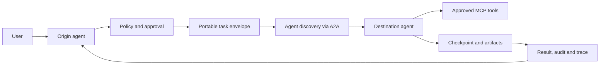

# Agent Movement

**Research-stage project: portable, interoperable, and governable AI-agent work across runtimes and environments.**

**Status:** Research and design only. **No production software or working integration is implemented in this repository yet.** Last reviewed: 2026-10-15.

## What does "agent movement" mean?

*Agent Movement* is the **proposed name and working definition for this project**, not a recognized universal standard. We use it to study how an AI-agent task or execution can move between agents, frameworks, models, machines, and organizations **without losing relevant context, accountability, or safety controls**.

Four distinct operations must not be conflated:

1. **Delegation / handoff:** Agent A asks Agent B to perform a task. Agent A need not expose or migrate its internals. A2A addresses this interface.
2. **Portable task context:** Transfer an explicit, policy-checked package of goals, inputs, artifact references, and resumable checkpoints.
3. **Runtime relocation:** Stop at a safe boundary and resume compatible execution elsewhere, with durable workflow state and idempotency controls. This is substantially harder than delegation.
4. **Cross-framework migration:** Reconstruct a workflow on a different runtime using an adapter and a portable representation, with explicitly documented loss of features.

**Not claimed:** Live process migration or lossless transfer of arbitrary agent hidden state, model internals, credentials, or in-flight side effects.

## Why this matters

A useful agent might start on a laptop, delegate to a cloud agent, use tools in another organization, pause for approval, and resume after failure. Today the building blocks span multiple layers:

| Layer | Relevant technologies | What they solve | What they do **not** solve |
| --- | --- | --- | --- |
| Agent-to-agent | [A2A](https://a2a-protocol.org/v1.0.0/specification/) | Discovery, messaging, tasks, artifacts, streaming | Generic checkpoint migration |
| Agent-to-tools/data | [MCP, spec 2026-07-28](https://modelcontextprotocol.io/specification/2026-07-28) | Structured access to external capabilities | Agent-to-agent execution transfer |
| Agent-to-user | [AG-UI](https://github.com/ag-ui-protocol/ag-ui) | Agent/frontend events, state, interaction | Migration between runtimes |
| Orchestration and recovery | [LangGraph](https://docs.langchain.com/oss/python/langgraph/persistence), [Temporal](https://docs.temporal.io/workflow-execution) | Checkpoints, durable execution and recovery | Automatic semantic compatibility across all frameworks |
| Deployments | [OCI](https://specs.opencontainers.org/image-spec/), [Kubernetes](https://kubernetes.io/docs/concepts/workloads/controllers/job/) | Portable packaging and workload scheduling | App-level state/identity migration |
| Trust, policy and audit | [OAuth token exchange](https://www.rfc-editor.org/rfc/rfc8693), [SPIFFE](https://spiffe.io/docs/latest/spire-about/spire-concepts/), [OPA](https://www.openpolicyagent.org/docs), [OpenTelemetry](https://github.com/open-telemetry/semantic-conventions-genai) | Delegated access patterns, workload identity, policy and telemetry | An end-to-end agent mobility protocol |

The *research hypothesis* is that a small **portable handoff envelope**, compatible adapters, strict authorization, and an auditable lifecycle could make these layers work together.

## Proposed flow (illustrative, not implemented)

The origin retains ownership of the user's intent and consent. Delegated privileges are scoped independently at the destination. Retries need explicit idempotency and reconciliation.

## Read the research

Suggested reading order:

1. [Agent movement vs copy, clone, replication and multiplication: status audit](docs/agent-movement-vs-copy-replication-multiplication.md): vocabulary, and what is (not) implemented
2. [Glossary: 70 terms, each tagged as standard, research or project working definition](docs/glossary.md)
3. [Research landscape and technology comparison](docs/research-landscape.md): what A2A, MCP, LangGraph, Temporal and others do and do not solve
4. [Standards and protocol version tracker (28 specs, primary sources, checked 2026-10-16)](docs/standards-tracker.md) · [CSV](data/standards-tracker.csv)
5. [How movement would work: lifecycle and draft handoff envelope](docs/how-it-works.md)
6. [Device compatibility and capability requirements (134 candidate device classes)](docs/device-compatibility-and-capability-matrix.md) · [CSV catalog](data/device-targets.csv)
7. [Security, privacy, and threat model](docs/security-and-trust.md)
8. [Agent fingerprints, movement tracking, and digital forensics](docs/agent-forensics-and-fingerprints.md): identity vs fingerprint, evidence grades, auditable movement receipts
9. [Open technical and product questions](docs/open-questions.md): ranked questions with falsifiable experiments
10. [Evidence map: which corpus items bear on each open question, and where evidence is missing](docs/evidence-map.md) · [CSV](data/evidence-map.csv)
11. [Proposed architecture and staged roadmap](docs/roadmap.md)
12. [Primary sources and evidence log](docs/sources.md): index of the references cited in the core research docs, with a spot-check log
13. [News corpus: 100 dated, verified and coded news items (2024–2026) with summaries, BibTeX and protocol](docs/news-corpus/README.md) ([digest](docs/news-corpus/digest.md))
14. [Paper corpus: 83 metadata-verified, audited scholarly papers (1980–2026), from mobile agents and process migration to MCP/A2A security](docs/paper-corpus/README.md) ([digest](docs/paper-corpus/digest.md))
15. [Corpus timeline and coverage analysis (generated)](docs/corpus-analysis/README.md)
16. [How to cite this repository or a corpus item](docs/how-to-cite.md) · [Development and quality gates](docs/development.md)

## Recommended initial experiment

Demonstrate a **local-first, non-destructive** A2A handoff between two test agents: discover capabilities, require explicit approval for a simulated action, send a task envelope with no secrets, return an artifact, and show correlated audit events. Then test crash recovery and deduplication before claiming any "agent migration".

See [roadmap](docs/roadmap.md) for measurable acceptance criteria. This is a **recommendation**, not an implemented or approved product direction.

## Contribute

Research corrections, protocol compatibility experiments, concrete failure modes, and reproducible benchmarks are especially welcome. Distinguish **verified protocol behavior** from **proposed project design** and link to primary sources; add any new citation to [docs/sources.md](docs/sources.md). No credentials, private conversations, or confidential task payloads should ever be committed.

**License:** Not selected. Until a license is added by the repository owner, do not assume this repository grants open-source reuse rights.

---
Sources were reviewed on **2026-10-15**; upstream protocols and SDKs continue to evolve.
