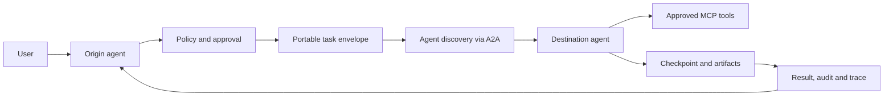

# Agent Movement

<!-- positioning:start -->
Agent Movement is a research prototype: an open, evidence-first testbed built to make claims about safely moving AI-agent work between executors falsifiable. It currently pairs ranked research questions with synthetic, localhost-only Python prototypes and MobilityBench v0.1, a frozen, deterministic, LLM-free benchmark of 18 synthetic tasks that scores keeping, restarting, delegating (locally or over A2A) and checkpoint-relocating work under injected faults, with the A2A and relocation modes enabled by optional extras, and reports refusals and unavailable baselines instead of hiding them. It is not production software, a new agent protocol or a rival to A2A or MCP.
<!-- positioning:end -->

**Status:** Research-stage. Alongside the research documents, the repository has an **experimental Python package of synthetic, local prototypes**: loopback task handoff with simulated-effect fencing, an optional A2A v1 adapter on the official SDK, authenticated peer handoff, same-runtime LangGraph checkpoint relocation, signed movement receipts and the MobilityBench harness. None of it is production software. It does **not** provide production security, broad A2A interoperability (one second SDK, a JavaScript client, and the official A2A TCK have been run on loopback, with documented deviations), cross-framework reconstruction or deployment to other devices. Current release: **v0.2.0** (2026-10-16); see the [CHANGELOG](CHANGELOG.md). Last reviewed: 2026-10-16.

## What does "agent movement" mean?

*Agent Movement* is the **proposed name and working definition for this project**, not a recognized universal standard. We use it to study how an AI-agent task or execution can move between agents, frameworks, models, machines, and organizations **without losing relevant context, accountability, or safety controls**.

Used this way, *agent movement* is an umbrella research term that covers the four operations below. A **move** in the strict sense means that ownership of the task transfers to a different executor (operations 2–4). Delegation keeps the origin as the owner, so it is in scope for the research but is not a move ([terminology decisions](docs/glossary.md#terminology-decisions-2026-10-16)).

Four distinct operations must not be conflated:

1. **Delegation:** Agent A asks Agent B to perform a task. Agent A need not expose or migrate its internals. A2A addresses this interface.
2. **Portable task context:** Transfer an explicit, policy-checked package of goals, inputs and artifact references. When a resumable checkpoint travels with it, the checkpoint is a separate, versioned contract that the package references (operation 3).
3. **Checkpoint relocation:** Stop at a safe boundary and resume compatible execution elsewhere, with durable workflow state and idempotency controls. This is substantially harder than delegation.
4. **Cross-framework reconstruction:** Reconstruct a workflow on a different runtime using an adapter and a portable representation, with explicitly documented loss of features.

**Not claimed:** Live process migration or lossless transfer of arbitrary agent hidden state, model internals, credentials, or in-flight side effects.

For the proposed trust model for **device/hardware-bound agents**, attested destinations and risk-tiered authorization, see [hardware binding and mobility safety](docs/device-and-hardware-binding.md).

## Why this matters

A useful agent might start on a laptop, delegate to a cloud agent, use tools in another organization, pause for approval, and resume after failure. Today the building blocks span multiple layers:

| Layer | Relevant technologies | What they solve | What they do **not** solve |
| --- | --- | --- | --- |
| Agent-to-agent | [A2A](https://a2a-protocol.org/v1.0.0/specification/) | Discovery, messaging, tasks, artifacts, streaming | Generic checkpoint relocation |
| Agent-to-tools/data | [MCP, spec 2026-07-28](https://modelcontextprotocol.io/specification/2026-07-28) | Structured access to external capabilities | Agent-to-agent execution transfer |
| Agent-to-user | [AG-UI](https://github.com/ag-ui-protocol/ag-ui) | Agent/frontend events, state, interaction | Migration between runtimes |
| Orchestration and recovery | [LangGraph](https://docs.langchain.com/oss/python/langgraph/persistence), [Temporal](https://docs.temporal.io/workflow-execution) | Checkpoints, durable execution and recovery | Automatic semantic compatibility across all frameworks |
| Deployments | [OCI](https://specs.opencontainers.org/image-spec/), [Kubernetes](https://kubernetes.io/docs/concepts/workloads/controllers/job/) | Portable packaging and workload scheduling | App-level state/identity migration |
| Trust, policy and audit | [OAuth token exchange](https://www.rfc-editor.org/rfc/rfc8693), [SPIFFE](https://spiffe.io/docs/latest/spire-about/spire-concepts/), [OPA](https://www.openpolicyagent.org/docs), [OpenTelemetry](https://github.com/open-telemetry/semantic-conventions-genai) | Delegated access patterns, workload identity, policy and telemetry | An end-to-end agent mobility protocol |

The *research hypothesis* is that a small **portable handoff envelope**, compatible adapters, strict authorization, and an auditable lifecycle could make these layers work together.

## Proposed flow (illustrative, not implemented)



The origin retains ownership of the user's intent and consent. Delegated privileges are scoped independently at the destination. Retries need explicit idempotency and reconciliation.

## Run the local experiments

The [local proof of concept](docs/local-implementation.md) uses two separate processes, a strict synthetic handoff envelope, a preconfigured receiver-side approval, SQLite-backed audit/receipt deduplication, and a separate simulated stale-worker fencing exercise. The core demo uses a **custom loopback HTTP interface, not A2A**. The optional [A2A v1 adapter](docs/a2a-adapter.md) carries the same envelope over the official A2A SDK, as specified by the [agent-movement A2A profile extension](docs/a2a-profile-extension.md).

The core needs Python 3.11+ and only the standard library. Each optional extra adds one experiment:

```sh
python -m pip install -e . pytest                     # core only
agent-movement demo                                   # handoff, replay, denial, stale-epoch fencing
agent-movement peer-demo                              # authenticated peer handoff (HS256, plaintext: no confidentiality)
agent-movement bench verify --suite v0.1              # MobilityBench v0.1 fixture digests (v0.2: --suite v0.2)
agent-movement purge --db FILE --older-than 30d --dry-run   # what a retention purge would delete
python -m pytest -q                                   # all tests: agent_movement + corpus tooling

python -m pip install -e '.[a2a,ed25519,hpke,relocation,signing]'   # every optional extra
agent-movement version                                # package version and installed extras
agent-movement a2a-demo                               # A2A v1 delegation via the official a2a-sdk
agent-movement peer-demo --alg Ed25519                # asymmetric peer keys, HPKE-sealed delivery
agent-movement relocate                               # LangGraph checkpoint relocation fault matrix
agent-movement relocate --two-store                   # same, checkpoint copied into Worker B's own store
agent-movement relocate reconcile --help             # operator reconciliation of parked unknown-outcome effects
agent-movement receipts verify tests/fixtures/movement-receipts/01-valid-delegation \
    --trust tests/fixtures/movement-receipts/trust.json --now 2026-10-16T00:00:00Z
agent-movement demo --receipts /tmp/am-receipts       # same demo, plus signed receipts verified offline
```

Each `agent-movement` subcommand forwards its arguments unchanged to an existing module, so `python -m agent_movement.demo`, `python -m agent_movement.mobilitybench` and the others still work. A subcommand whose optional extra is missing prints the install command and exits 2. Every subcommand and flag is listed in the [CLI reference](docs/cli.md), which a test checks against the live `--help` output.

The core demo outputs a completed task, an idempotent replay, a denied unapproved request, a rejected stale epoch, and a runtime revocation of the approval by a signed notice, after which a new handoff, a replay and the task's next effect are all refused (forged and unsigned notices get 401). On 2026-10-16 (commit 8fee89c, CPython 3.12.3), `python -m pytest -q` gave **796 passed, 8 skipped** with every extra installed and **551 passed, 253 skipped** with the core only; the skipped tests are the ones that need a missing extra or the optional gitleaks binary. CI runs both configurations ([`python-smoke.yml`](.github/workflows/python-smoke.yml)). No model credentials, live external tool effects, private data or public endpoints are required.

## Read the research

Suggested reading order:

1. [Agent movement vs copy, clone, replication and multiplication: status audit](docs/agent-movement-vs-copy-replication-multiplication.md): vocabulary, and what is (not) implemented
2. [Glossary: 74 terms, each tagged as standard, research or project working definition](docs/glossary.md)
3. [Research landscape and technology comparison](docs/research-landscape.md): what A2A, MCP, LangGraph, Temporal and others do and do not solve
4. **[How agents move: complete protocol and network guide](docs/protocols-and-networks/README.md)** — [protocol catalog](docs/protocols-and-networks/protocol-catalog.md), [network topologies](docs/protocols-and-networks/network-topologies.md), [handoff/relocation contract](docs/protocols-and-networks/handoff-and-relocation-contract.md), [security and failure recovery](docs/protocols-and-networks/security-reliability-and-observability.md), [decision and benchmark guide](docs/protocols-and-networks/decision-guide-and-benchmarks.md), [primary sources](docs/protocols-and-networks/primary-sources.md), [machine-readable CSV](data/protocol-network-matrix.csv)
5. [Standards and protocol version tracker (31 specs, primary sources, checked 2026-10-16)](docs/standards-tracker.md) · [CSV](data/standards-tracker.csv)
6. [How movement would work: lifecycle and draft handoff envelope](docs/how-it-works.md)
7. [Agent lifecycle, liveness, death and safe retirement (proposed model)](docs/agent-lifecycle-liveness-and-death.md)
8. [Device compatibility and capability requirements (134 candidate device classes)](docs/device-compatibility-and-capability-matrix.md) · [CSV catalog](data/device-targets.csv)
9. [Security, privacy, and threat model](docs/security-and-trust.md) · [Prompt injection across agent boundaries (taxonomy, evidence, proposed experiment)](docs/cross-agent-prompt-injection.md)
10. **[Can agents move unnoticed or cause harm? Defensive threat model](docs/unnoticed-and-unauthorized-agent-movement.md)** — permission boundaries, hidden delegation, lateral movement, independent detection, revocation and kill switches; [15 proposed synthetic defense tests](data/unnoticed-agent-movement-defense-tests.csv)
11. [Agent communication governance and enforceable policy proposal](docs/agent-communication-and-policy.md) · [28 conformance cases](data/agent-communication-conformance-cases.csv) · [Test registry: documented cases linked to implemented tests](data/test-registry.csv)
12. [Agent fingerprints, movement tracking, and digital forensics](docs/agent-forensics-and-fingerprints.md): identity vs fingerprint, evidence grades, auditable movement receipts
13. [Open technical and product questions](docs/open-questions.md): ranked questions with falsifiable experiments · [Question ID crosswalk](docs/question-id-crosswalk.md)
14. **[Algorithms and computer-science foundations](docs/algorithms-and-cs-foundations.md)**: distributed authority, formal invariants, model checking, graph/scheduling algorithms, semantic portability and a bounded state explorer
14. [Evidence map: which corpus items bear on each open question, and where evidence is missing](docs/evidence-map.md) · [CSV](data/evidence-map.csv)
16. [Proposed architecture and staged roadmap](docs/roadmap.md)
17. [Strategic target and scientific agenda](docs/strategic-target-and-scientific-agenda.md) · [MobilityBench experiment protocol (proposed pre-registration)](docs/mobilitybench-experiment-protocol.md) · [Economic evaluation methodology (proposed cost model, no results)](docs/economic-evaluation.md) · [Evaluation plan for reference tasks EV-A, EV-B and EV-C (design only, no results)](docs/evaluation-plan.md)
18. [2031 frontier: 20 visionary research questions and four testable studies](docs/2031-frontier-research-agenda.md)
19. [Primary sources and evidence log](docs/sources.md): index of the references cited in the core research docs, with a spot-check log
20. [News corpus: 100 dated, verified and coded news items (2024–2026) with summaries, BibTeX and protocol](docs/news-corpus/README.md) ([digest](docs/news-corpus/digest.md))
21. [Paper corpus: 83 metadata-verified, audited scholarly papers (1980–2026), from mobile agents and process migration to MCP/A2A security](docs/paper-corpus/README.md) ([digest](docs/paper-corpus/digest.md))
22. [Corpus timeline and coverage analysis (generated)](docs/corpus-analysis/README.md)
23. [Corpus link health and Wayback availability (2026-10-16): no dead links; 16 cited URLs not yet archived](docs/corpus-qa/README.md)
24. [How to cite this repository or a corpus item](docs/how-to-cite.md) · [Development and quality gates](docs/development.md) · [Contributing](CONTRIBUTING.md) · [Security policy](SECURITY.md)

Further research notes:

- [Underexplored dimensions and proposed experiments (2026-10-16 gap audit)](docs/missing-dimensions-and-research-gaps.md): multi-principal authority, portable obligations, self-change, quarantine, human control and context freshness
- [Twenty high-impact research questions for AI agents and human life (reasoned agenda, not a systematic review)](docs/top-20-human-impact-questions-for-agentic-ai.md)

Experimental code (synthetic, local, not production):

- [Continuity Guard v0.1: multi-principal approval, obligations, configuration drift, quarantine and freshness (research-only)](docs/continuity-guard-v0.md) — deterministic 10-case demo and synthetic unit tests
- [Continuity Runtime v0.1: signed facts and SQLite effect-side rechecks for one peer receiver](docs/continuity-runtime-enforcement.md) — bounded enforcement with non-covered routes explicitly documented
- [Abstract protected-relocation model checker](tools/movement_modelcheck.py) · [its six focused tests](tests/test_movement_modelcheck.py) · [assumptions, invariants, counterexample and research agenda](docs/algorithms-and-cs-foundations.md)
- [Executable local handoff, tests, limits and next implementation milestones](docs/local-implementation.md) · [As-built architecture of the `agent_movement` package (verified against `dac5f62`)](docs/architecture.md)
- [`agent-movement` CLI reference: every subcommand, flag, optional extra and exit code](docs/cli.md)
- [Language and SDK strategy (public proposal; Python-first, with what is implemented so far)](docs/language-and-sdk-strategy.md)
- [Optional A2A v1 adapter on the official SDK: delegation, not migration; experimental, unauthenticated](docs/a2a-adapter.md)
- [A2A profile extension spec: the resolvable extension URI, envelope ↔ A2A field mapping, error codes and the server-generated contextId policy](docs/a2a-profile-extension.md)
- [Peer authentication and pre-disclosure authorization (synthetic, local; `python -m agent_movement.peer_demo`), with optional HPKE-sealed delivery](docs/peer-authentication.md)
- [Same-runtime checkpoint relocation (pinned LangGraph) with a 30-row crash/duplicate fault matrix, plus a two-store mode that copies the checkpoint as a digest-verified bundle (11 copy fault rows) and operator reconciliation of parked unknown-outcome effects (9 rows)](docs/checkpoint-relocation.md) (optional extra: `pip install -e '.[relocation]'`)
- [Signed movement receipts and offline forensic verifier (experimental, synthetic fixtures)](docs/movement-receipts.md)
- [Data retention: what the stores keep and why, keyed (salted) digest commitments, and `agent-movement purge --older-than`](docs/data-retention.md)

## Executable human-impact research pilot

The [human-impact research lab protocol](docs/human-impact-research-lab.md) maps real-world questions about control, identity, privacy, accountability, replication and task continuity onto falsifiable **synthetic** experiments. Run:

~~~sh
python -m pip install -e . pytest
agent-movement bench smoke --output mobilitybench-local.jsonl   # = python -m agent_movement.mobilitybench --output ...
python -m pytest -q          # all tests: agent_movement + corpus tooling
~~~

The local smoke suite models 20 cases. Each case declares its expected verdict in a packaged fixture and runs in its own temporary database, and `--no-timing` makes two runs byte-identical. On 2026-10-16, **18 cases reproduced their expected narrow behavior and 2 reproduced known gaps, which are not security successes.** The two gap cases attack the core path: a forged origin claim and a forged unsigned receipt. The peer-authentication and signed-receipt modules close them on separate paths only. A former third gap, an effect commit after revocation, is closed on the core path by a runtime revocation API with a signed notice and a recheck at the simulated effect commit (issue #38); its case was rewritten as a pass. This is not A2A, trusted peer identity, portable live state or a production system. See the experiment protocol for limits and next steps.

[MobilityBench v0.1](docs/mobilitybench-v0.1.md) extends this with 18 frozen, digest-verified synthetic tasks across three workload families: document work, constrained coding and simulated tools. It compares keep-on-origin, restart-on-destination and the PR #6 local delegate under seeded faults. With the optional extras installed (`pip install -e '.[a2a,relocation]'`) it also scores delegation over the official A2A v1 SDK and same-runtime checkpoint relocation; without them those two modes are explicit **unavailable** records. Cross-framework reconstruction is always reported as unavailable. Run it with `agent-movement bench run --suite v0.1 --out results.jsonl`, then `agent-movement bench report --in results.jsonl` (or the same subcommands of `python -m agent_movement.mobilitybench`). The suite is deterministic and LLM-free, so it supports no general statistical claims. [MobilityBench v0.2](docs/mobilitybench-v0.2.md) (`--suite v0.2`) runs the same tasks as a separate frozen release with mid-step crashes, origin-destination partitions and a `restart_stable_ids` baseline that reuses deterministic effect IDs, and records why a fault could not act on a mode.

## Recommended initial experiment

First synthetic, local slices now exist for the non-A2A task handoff and deduplication test, an A2A v1 SDK-based delegation between two processes, peer authentication *before input disclosure*, and same-runtime checkpoint relocation under injected crashes. The A2A adapter has been checked on loopback with the official A2A TCK and the Inspector validators, with documented deviations, and against a client built on the official JavaScript SDK (one direction, one second SDK); see [the adapter doc](docs/a2a-adapter.md#conformance-official-a2a-tck-and-inspector). Cross-framework reconstruction, real devices and production security remain research proposals.

See [local implementation](docs/local-implementation.md) for the ordered next steps and [roadmap](docs/roadmap.md) for the staged plan.

## Contribute

Research corrections, protocol compatibility experiments, concrete failure modes, and reproducible benchmarks are especially welcome. Distinguish **verified protocol behavior** from **proposed project design** and link to primary sources; add any new citation to [docs/sources.md](docs/sources.md). No credentials, private conversations, or confidential task payloads should ever be committed.

**License:** Not selected. Until a license is added by the repository owner, do not assume this repository grants open-source reuse rights.

---
Sources were reviewed on **2026-10-15**; upstream protocols and SDKs continue to evolve.
