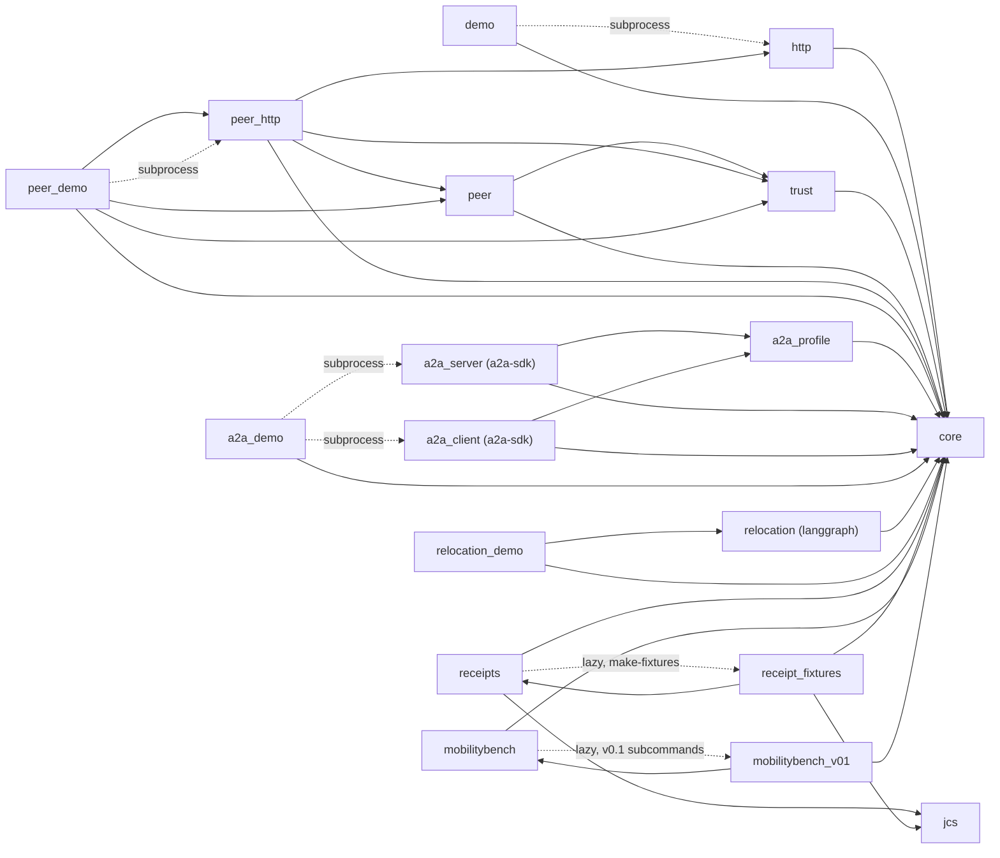
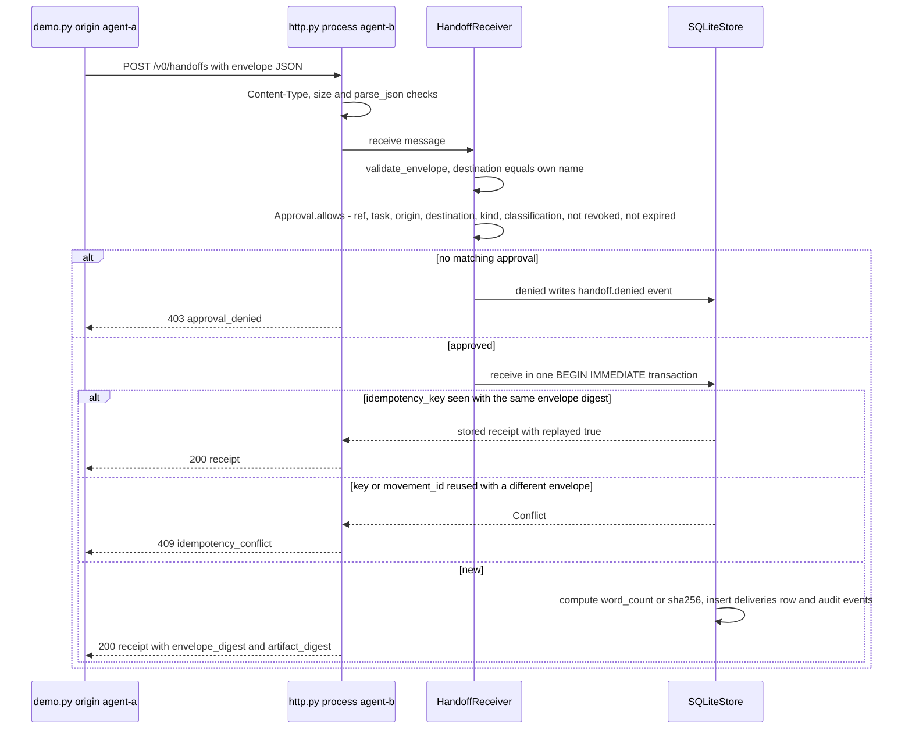
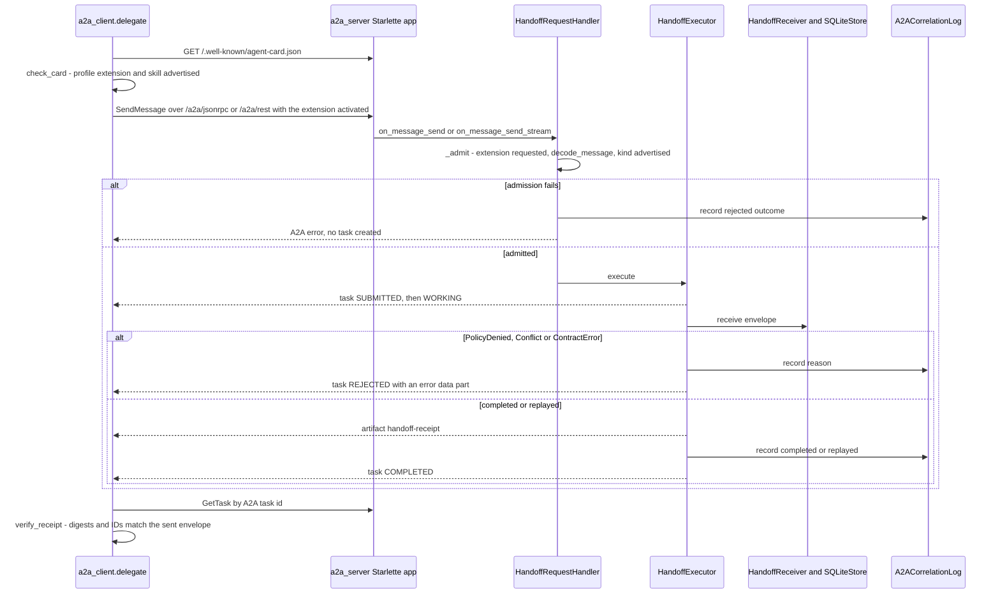
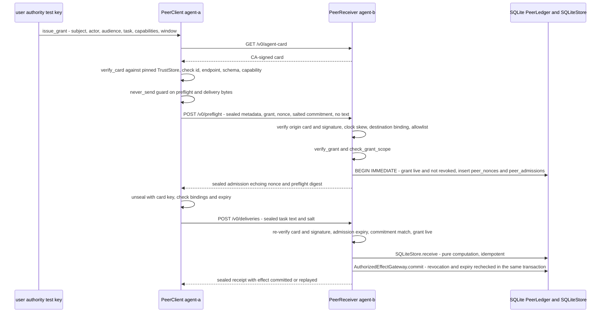
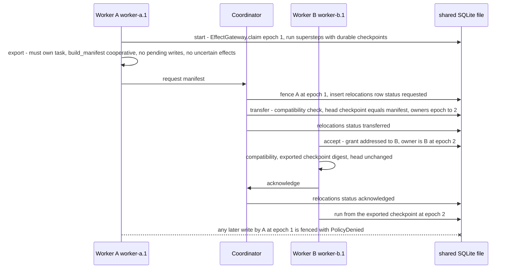
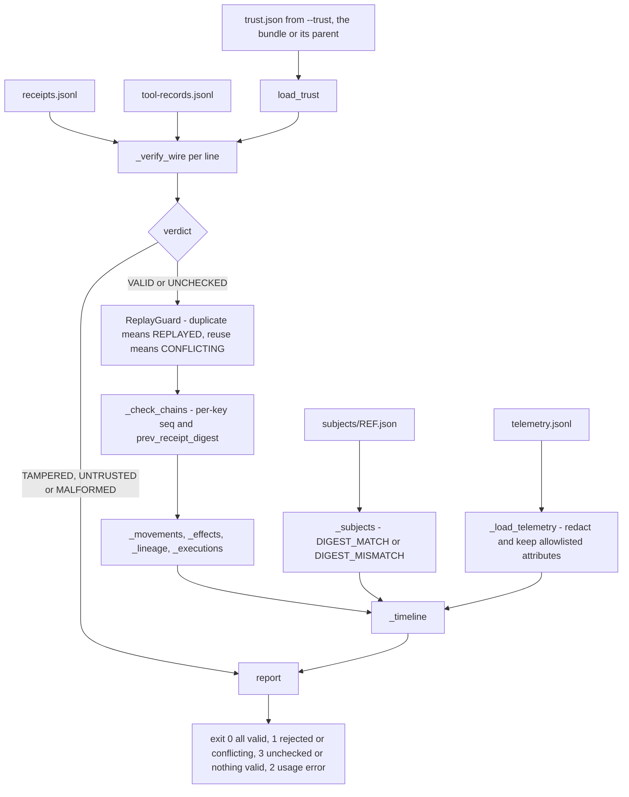
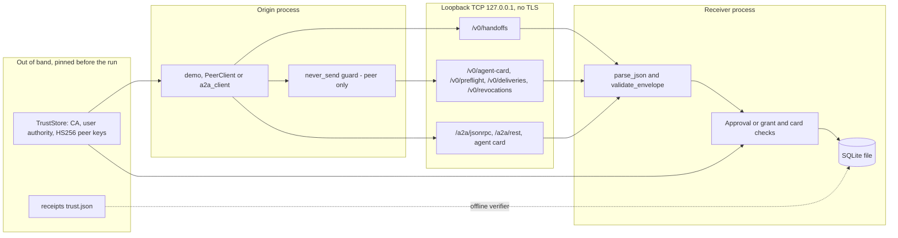

# As-built architecture of the `agent_movement` package

**Status:** Describes the code as it is, not as it is planned. The package is a research-stage set of **synthetic, local prototypes**, not production software.
**Last verified against commit `b21da27`** (`main`, 2026-10-16). Every module, class, function, command, table and column named here was checked against that commit with `grep` or by importing it, and every demo was run (see the [development guide](development.md#the-agent_movement-package) for the commands and their exit codes). If the code has changed since then, the code is authoritative.

> **Snapshot notice.** At the time of writing, `src/` is being changed by follow-up work on issues #18–#42. This document describes `b21da27` only and will be refreshed after that work lands. Check `git log -- src/agent_movement` for later changes before relying on a detail.

For the reasons behind each slice, see the topic documents: [local implementation](local-implementation.md), [A2A adapter](a2a-adapter.md), [peer authentication](peer-authentication.md), [checkpoint relocation](checkpoint-relocation.md), [movement receipts](movement-receipts.md) and [MobilityBench v0.1](mobilitybench-v0.1.md). For setup, tests and CI, see the [development guide](development.md#the-agent_movement-package).

## 1. What is real and what is simulated

| Aspect | Real | Synthetic or simulated |
|---|---|---|
| Processes | The demos start separate OS processes (`subprocess.Popen`; `os.fork` in `relocation_demo`). | Every "agent" is a small Python function. No model is called and there are no LLM credentials. |
| Network | Real HTTP over TCP, bound to `127.0.0.1` only (`http.make_server`, `peer_http.make_peer_server`, uvicorn in `a2a_server.main`). | No TLS, no channel binding and no cross-host transfer. Peer card endpoints must be `http://127.0.0.1:<port>` or `local://<name>` (`trust._ENDPOINT`). |
| A2A | The official `a2a-sdk` (pinned `1.2.2`) frames the messages on both ends: Agent Card, JSON-RPC, HTTP+JSON and SSE. | Both ends use the same SDK, so independent interoperability has not been tested. The card declares no security scheme. |
| Cryptography | Real HMAC-SHA256 (`trust.HmacKey`) and real Ed25519 (`trust.Ed25519Key`, `receipts.Ed25519Signer`, through the `cryptography` package). SHA-256 digests. | Keys are throw-away test keys generated for each run. The receipt fixture seeds are public (`receipt_fixtures.synthetic_seed`). There is no PKI, X.509 or OAuth. |
| Persistence | Real SQLite transactions (`BEGIN IMMEDIATE`, WAL mode) and real LangGraph `SqliteSaver` checkpoints. | The demos and benchmarks keep their SQLite files in temporary directories that are deleted at exit (see [§5](#5-storage-schema)). Origin and receiver of a relocation share one file. |
| Tasks | Two real pure computations: `word_count` and `sha256` (`core.SQLiteStore.receive`). | The input text is synthetic. Only the classifications `synthetic` and `public` are accepted. |
| External effects | None. | "Effects" are rows in SQLite tables: `effects`, `authorized_effects` and `opaque_effects`. No third-party tool is ever called. |
| Faults | Hard crashes are real process exits (`os._exit(CRASH_EXIT)`, `CRASH_EXIT = 86`, in `relocation.Faults.hit`). | The fault schedules are scripted. In MobilityBench the faults (`mobilitybench_v01.FAULT_KINDS`) are simulated by a deterministic interpreter inside one process; no model is called (`MODEL = "none"`). |
| Identity | Peer identity is proof of possession of a key pinned in a `TrustStore`. Receipt principals are bound to keys by a trust-anchor file. | In `core`, the A2A adapter and MobilityBench, `agent_id` strings are **unauthenticated claims**. |

## 2. Module map

All modules are in `src/agent_movement/`. The core is standard-library only. Each optional extra (see [`pyproject.toml`](../pyproject.toml)) enables one group of modules. Without its extra, a module either fails closed with a hint or reports results as unchecked.

| Module | Group / extra | Entry point | Main contents |
|---|---|---|---|
| `__init__.py` | core | none | Re-exports `Approval`, `Conflict`, `ContractError`, `EffectGateway`, `HandoffReceiver`, `PolicyDenied` and `SQLiteStore`. |
| `core.py` | core | none | `SCHEMA_VERSION = "0.1.0-draft"`. `parse_json` (strict: rejects duplicate keys and NaN, 16 KiB limit), `canonical`, `digest`, `validate_envelope`. `Approval`, `SQLiteStore`, `HandoffReceiver`, `EffectGateway`. Exceptions: `ContractError`, `PolicyDenied`, `Conflict`. |
| `http.py` | core | `python -m agent_movement.http --db PATH [--port 0]` | `LocalServer` (a `ThreadingHTTPServer`) and `make_server`. Routes: `GET /health` and `POST /v0/handoffs`. Errors map to 400, 403, 409, 413, 415 and 500. |
| `demo.py` | core | `python -m agent_movement.demo` | Starts `agent_movement.http` as a child process, then sends a handoff, an exact replay and an unapproved request. Finally runs an in-process `EffectGateway` stale-epoch check. |
| `jcs.py` | core | none | `canonicalize` and `jcs_digest`: a documented subset of RFC 8785 that rejects floats. |
| `trust.py` | core (`ed25519` extra for asymmetric keys) | none | `HmacKey`, `Ed25519Key`, `generate_key`, `import_key`, `seal`/`unseal` (signatures domain-separated by purpose), `TrustStore`, `issue_card`/`verify_card`, `issue_grant`/`verify_grant`/`check_grant_live`/`check_grant_scope`, `issue_revocation`/`verify_revocation`, `commitment`. |
| `peer.py` | core | none | `PeerLedger`, `AuthorizedEffectGateway`, `PeerReceiver` (`handle`), `PeerClient` (`discover`, `handoff`), and the transports `InProcessTransport`, `HttpTransport` and `RecordingTransport`. |
| `peer_http.py` | core | `python -m agent_movement.peer_http --config FILE` | `make_peer_server` and `load_receiver`. Binds exactly the loopback port named in the receiver's card. |
| `peer_demo.py` | core (`--alg Ed25519` needs `ed25519`) | `python -m agent_movement.peer_demo [--alg HS256\|Ed25519]` | One honest handoff and nine attack scenarios against a receiver running as a child process. Checks that no task text is sent before a denial. |
| `a2a_profile.py` | core (does not import the SDK) | none | `EXTENSION_URI`, `TASK_MEDIA_TYPE`, `RECEIPT_MEDIA_TYPE`, `envelope_to_a2a`, `a2a_to_envelope`, `receipt_to_artifact`, `verify_receipt`, `A2ACorrelationLog`. |
| `a2a_server.py` | `a2a` | `python -m agent_movement.a2a_server --db PATH` | `build_agent_card`, `decode_message`, `HandoffRequestHandler` (admits a request before any task exists), `HandoffExecutor` (wraps `core.HandoffReceiver`) and `build_app` (Starlette). |
| `a2a_client.py` | `a2a` | `python -m agent_movement.a2a_client --url URL --envelope FILE` | `check_card`, `build_message` and `delegate` (async). Uses the SDK `ClientFactory` over JSON-RPC or HTTP+JSON. Exits 3 unless the final task state is `TASK_STATE_COMPLETED`. |
| `a2a_demo.py` | `a2a` (the orchestrator itself is stdlib) | `python -m agent_movement.a2a_demo` | Server process plus five client processes (completed, retry, denied, unknown capability, unknown schema). Joins the results with the receiver tables. Exits 2 when the extra is missing. |
| `relocation.py` | `relocation` (LangGraph, exact pins) | none | `PINNED_RUNTIME`, `CRASH_POINTS`, `init_store`, `FencedSqliteSaver`, `EffectLedger`, `OpaqueTool`, `build_graph`, `build_manifest`, `compatibility`, `Coordinator`, `Worker`, `observe`. |
| `relocation_demo.py` | `relocation` (POSIX `os.fork`) | `python -m agent_movement.relocation_demo [--json FILE]` | A headline relocation (`headline`) plus a 30-row crash, duplicate and version fault matrix (`run_matrix`). Each actor action runs in a forked child (`run_actor`). Without the extra, the import of `relocation` raises `ImportError` with an install hint (exit 1). |
| `receipts.py` | `signing` for signature checks | `python -m agent_movement.receipts {verify,timeline,make-fixtures}` | Receipt schema `agent-movement.receipt/0.1-draft`. `validate_body`, `Ed25519Signer`, `commitment`, `body_from_handoff`, `load_trust`, `ReplayGuard`, `verify_bundle` and `render_text`. Exit codes in [§3.5](#35-receipt-verification-offline). |
| `receipt_fixtures.py` | `signing` | through `receipts make-fixtures DIR` | Nine deterministic scenarios (`SCENARIOS`) and their `EXPECTED` results. They are built on real runs of `HandoffReceiver` and `EffectGateway` (`pr6_handoff`, `gateway_epochs`). |
| `mobilitybench.py` | core | `python -m agent_movement.mobilitybench [--output FILE]` | A 20-case local smoke suite (`run_suite`). The subcommands `run`, `report`, `verify` and `schedule` are passed on to `mobilitybench_v01`. |
| `mobilitybench_v01.py` | core | through `mobilitybench {run,report,verify,schedule}` | A frozen-fixture loader with a SHA-256 manifest check (`verify_fixtures`), a scripted interpreter (`AgentState`, `Attempt`), baselines (`MODES`, `RUNNERS`), security-case handlers (`SECURITY`), `fault_schedule`, `run_suite`, `summarize` and `build_report`. `run` exits 1 on a harness error, a failed security case or a reproducibility mismatch, and 2 if the fixtures fail verification. |
| `fixtures/mobilitybench-v0.1/` | package data | none | `tasks.jsonl` (18), `ground_truth.jsonl` (18), `negative.jsonl` (12), `seeds.json` and `MANIFEST.json`. |

One maintainer script outside the package is related: `tools/mobilitybench_freeze.py` recomputes `ground_truth.jsonl` and `MANIFEST.json`, or checks them with `--check`.

### Import dependencies

Solid arrows are module-level Python imports inside the package. Dotted arrows labelled `subprocess` start a child process with `python -m`; dotted arrows labelled `lazy` are imports inside a function. Only `a2a_server` and `a2a_client` (`a2a-sdk`, `httpx`, `starlette`, `protobuf`, `uvicorn`), `relocation` (`langgraph`) and the Ed25519 paths in `trust`, `receipts` and `receipt_fixtures` (`cryptography`) import third-party code. `trust` and `receipts` import `cryptography` only when it is installed.

## 3. Data flows

### 3.1 Delegation over loopback HTTP (core, not A2A)

`demo.main` sends a `0.1.0-draft` envelope to a receiver process. `validate_envelope` accepts exactly 11 top-level fields and rejects anything else. That includes unknown fields, other task kinds, other classifications and text longer than 2048 bytes.

A malformed body or envelope returns 400 `invalid_contract` before any of this runs.

The same `SQLiteStore` provides the **simulated** effect fence, `EffectGateway`. `claim` inserts an `owners` row at epoch 1. `transfer` compares the owner and epoch and then increments the epoch. `commit` rereads `owners` in the same transaction as the `effects` insert, so a stale epoch raises `PolicyDenied`. `reconcile` returns `committed` or `unknown`. The receipt is **unsigned**, and its digests are unsalted SHA-256 values over canonical JSON that contains the task text.

### 3.2 Delegation over A2A v1 (optional `a2a` extra)

The A2A path reuses `HandoffReceiver` unchanged. `a2a_profile` maps envelope fields into `Message.metadata[EXTENSION_URI]` and puts `{kind, text}` into a single data part with the media type `application/vnd.agent-movement.task+json`.

This shows **delegation**, not migration. Nothing is authenticated, and the agent IDs remain claims.

### 3.3 Authenticated pre-disclosure handoff (`trust` and `peer`)

`PeerClient.handoff` sends metadata before the payload. The task text leaves the origin only after it has verified the destination card and a receiver-signed admission. Every message is a `seal` object `{alg, kid, payload, sig}`, and each signature covers a purpose-specific domain (`agent-card`, `grant`, `preflight`, `admission`, `delivery`, `receipt` or `revocation`).

A grant issuer can post a signed revocation to `POST /v0/revocations`. `PeerLedger.revoke` and `AuthorizedEffectGateway.commit` both use `BEGIN IMMEDIATE`, so whichever commits first wins. If a revocation arrives after delivery has started, the task text has already been sent but the effect is refused. `peer_demo` reports this case as `revoked-in-flight`. Peers receive only coarse HTTP errors (400, 401, 403 or 409). The specific reason is written only to `peer_trace`.

### 3.4 Checkpoint relocation (optional `relocation` extra)

A logical task is one LangGraph `thread_id`. An execution is `worker_id.incarnation`. Ownership is the core `owners` row (`agent_id`, `epoch`). Every write rechecks it inside its own SQLite transaction (`relocation._fence`): checkpoint writes in `FencedSqliteSaver.cursor`, `EffectLedger.record_intent`/`mark` and `OpaqueTool.invoke`.

`Coordinator.failover` builds a `failover` manifest from the durable head without the origin's help. It is used when the origin or the receiver crashed. `compatibility` refuses on any mismatch (`refuse_fail_closed`) in the profile, the pinned runtime, the graph ID or version, the checkpoint format or the channels. The effect node writes an intent before the call, marks `attempt_started`, and calls either `EffectGateway.commit` (idempotent and queryable) or `OpaqueTool.invoke` (neither). For `opaque`, an interrupted call becomes `unknown` and the run ends with `reconcile_required` instead of retrying. Origin and receiver share **one local file**: no checkpoint bytes cross a host.

### 3.5 Receipt verification (offline)

`python -m agent_movement.receipts verify BUNDLE` reads an evidence bundle directory and never contacts the network.

`_verify_wire` checks the following, in order: the strict JSON wire shape `{receipt, body_digest, signature}`, a credential scan (`contains_token_like`), `validate_body`, the `jcs_digest` match, the signature block against `issuer.key_id`, whether the key is in the trust anchors, Ed25519 over `SIGNATURE_DOMAIN || canonicalize(body)`, the key validity window and revocation at the claimed `issued_at`, the claimed principal, and the signer role (`tool` keys for `tool.effect_recorded`, `agent` keys for everything else). Without the `signing` extra, signatures are reported as `UNCHECKED` and the exit code is 3. Evidence grades are `E1` (unverified claim), `E2` (verified signature) and `E3` (an agent claim corroborated by an independent tool record, or both sides of a movement verified). `E0` is never assigned.

### 3.6 MobilityBench (core)

`mobilitybench.run_suite` runs 20 scripted cases directly against the core classes (at `b21da27`: 17 pass, 3 are reported as `known_gap`). `mobilitybench_v01.run_suite` first loads the packaged fixtures and checks them against `MANIFEST.json`, then runs every selected task in each mode of `MODES` under the seeded `fault_schedule`, then runs the 12 negative cases of `negative.jsonl` through the 10 attack handlers in `SECURITY` (two cases share `classification_gate` and two share `run_task`). It returns the records, which the CLI writes as JSONL. Three modes are implemented: `keep_on_origin`, `restart_on_destination` and `local_delegate` (which uses an in-process `HandoffReceiver`). Three are emitted as `unavailable`: `a2a_delegate`, `checkpoint_relocate` and `cross_framework_reconstruct`. `run_suite` raises `RuntimeError` if any `redact_terms` string from the fixtures or the `CANARY` string appears in the records. No model is called (`MODEL = "none"`).

MobilityBench therefore measures the core handoff and fencing logic under scripted faults. It does not exercise the A2A adapter, peer authentication or checkpoint relocation, even though those modules exist.

## 4. Trust boundaries

| Boundary | What is enforced in code | What is **not** enforced |
|---|---|---|
| Network bind | All servers bind `127.0.0.1` (`http.make_server`, `peer_http.make_peer_server`, `a2a_server.main`). `peer.HttpTransport` refuses any URL that is not loopback. | TLS, authentication of the HTTP peer, rate limits. |
| Input parsing | `core.parse_json` rejects duplicate keys and NaN/Infinity and limits the body to 16 KiB. The two stdlib servers (`http`, `peer_http`) require `application/json` and `0 < Content-Length <= 16384`; the A2A server relies on the SDK for framing and then applies `decode_message`. Envelope, preflight, delivery and receipt objects must have exact field sets. | A schema language. The checks are hand-written. |
| Core authorization | `Approval.allows` is a receiver-local allowlist entry with an expiry. | Sender identity. `origin.agent_id` is only a claim. |
| Peer identity | The card is signed by a pinned CA. The request is signed with the key the card names. Cards are bound to an endpoint. The admission is bound to the client nonce and the preflight digest. | Channel binding. HS256 keys are symmetric, so any verifier can also forge signatures; only Ed25519 rules this out. |
| User authority | Grants are scoped by actor, audience, task, capabilities, classification and validity window, and are rechecked at preflight, at delivery and inside the effect transaction. | A real OAuth/RFC 8693 exchange. |
| Disclosure | Only a salted commitment travels before admission. `PeerClient` refuses to send bytes that contain a `never_send` value or its own secret key. | Disclosure after delivery has started, for example `revoked-in-flight`. |
| Ownership | The `owners` epoch is checked in the same transaction as every fenced write. | Tools outside the simulated gateway. `OpaqueTool` outcomes can stay `unknown`. |
| Evidence | Trust anchors are loaded from a separate file (`--trust`, otherwise `trust.json` in the bundle or its parent), not from the receipts. Agent labels stay `claimed_agent_id`. | Anchor provenance: the verifier's own `receipts.LIMITS` say that anchors shipped inside a bundle prove nothing. Trusted time: `issued_at` is the signer's claim. Completeness: a bundle may be missing receipts. |

## 5. Storage schema

All persistent state is SQLite. One file can hold several groups of tables, because each class adds its own `CREATE TABLE IF NOT EXISTS` statements to the same path.

| Table | Created by | Columns (key in **bold**) | Contents |
|---|---|---|---|
| `deliveries` | `core.SQLiteStore` | **`idempotency_key`**, `movement_id` (UNIQUE), `envelope_digest`, `receipt_json` | One memoized receipt per operation. |
| `audit_events` | `core.SQLiteStore` | **`seq`**, `movement_id`, `task_id`, `event_type`, `info_digest`, `event_time` | `handoff.accepted`, `handoff.completed` and `handoff.denied` events. Stores digests only, never task text. |
| `owners` | `core.SQLiteStore` | **`task_id`**, `agent_id`, `epoch` | The ownership epoch used by `EffectGateway` and by `relocation`. |
| `effects` | `core.SQLiteStore` | **`task_id`, `effect_id`**, `payload_digest`, `epoch` | Simulated, fenced effect commits. |
| `a2a_correlations` | `a2a_profile.A2ACorrelationLog` | **`seq`**, `a2a_task_id`, `a2a_context_id`, `a2a_message_id`, `movement_id`, `trace_id`, `outcome`, `envelope_digest`, `artifact_digest`, `event_time` | Joins A2A IDs to handoff outcomes. IDs that are not safe tokens are hashed (`safe_token`). |
| `peer_nonces` | `peer.PeerLedger` | **`origin_id`, `nonce`**, `seen_at` | Replay protection for preflights. Old rows are pruned. |
| `peer_admissions` | `peer.PeerLedger` | **`admission_id`**, `movement_id` (UNIQUE), `record_json`, `expires_at` | Admitted preflight metadata, including the commitment. Never contains task text. |
| `authority_log` | `peer.PeerLedger` | **`seq`**, `event`, `grant_id`, `ref`, `at` | `revoke` and `effect` events in commit order. |
| `grant_revocations` | `peer.PeerLedger` | **`grant_id`**, `revoked_at`, `log_seq` | Revoked grants. |
| `authorized_effects` | `peer.PeerLedger` | **`task_id`, `effect_id`**, `grant_id`, `agent_id`, `payload_digest`, `log_seq` | Simulated effects committed under a live grant. |
| `peer_trace` | `peer.PeerLedger` | **`seq`**, `at`, `stage`, `outcome`, `reason`, `movement_id`, `peer`, `claimed_peer`, `admission_id` | A sanitized decision trace. `peer` is the authenticated ID and `claimed_peer` is the unauthenticated claim. |
| `relocations` | `relocation.init_store` | **`movement_id`**, `task_id`, `mode`, `from_execution`, `from_epoch`, `to_execution`, `to_epoch`, `checkpoint_id`, `manifest_json`, `manifest_digest`, `status`, `report_json` | `status`: `requested`, `transferred`, `acknowledged`, `refused` or `superseded`. |
| `effect_intents` | `relocation.init_store` | **`task_id`, `effect_id`**, `payload_digest`, `tool`, `status`, `execution_id`, `epoch`, `attempts` | A write-ahead effect ledger. `status`: `intent`, `attempt_started`, `committed`, `reconciled_committed` or `unknown`. |
| `opaque_effects` | `relocation.init_store` | **`seq`**, `task_id`, `effect_id`, `payload_digest`, `execution_id`, `epoch` | Ground truth for the non-idempotent tool. Only the harness reads it. |
| `node_runs` | `relocation.init_store` | **`seq`**, `task_id`, `execution_id`, `epoch`, `node`, `item_index` | Harness instrumentation: every node attempt. |
| `checkpoints`, `writes` | LangGraph `SqliteSaver.setup()` (through `init_store`) | Defined by `langgraph-checkpoint-sqlite` 3.1.2 | Durable graph checkpoints. `Coordinator.transfer` reads `checkpoints.checkpoint_id` directly. |

Which file holds which tables:

- `demo` and `http`: `ledger.sqlite` holds the core tables.
- `peer_demo`: `receiver.sqlite` holds the core and peer tables.
- `a2a_demo`: `receiver.sqlite` holds the core tables and `a2a_correlations`.
- `relocation_demo`: one `<scenario>.sqlite` per matrix row holds the core, relocation and LangGraph tables.
- `mobilitybench` (20-case suite): one `suite.sqlite` shared by the ordered cases, holding the core tables.
- `mobilitybench_v01`: `effects.sqlite` per attempt (core tables used by `EffectGateway`), plus `receiver.sqlite` for `local_delegate` attempts and `neg.sqlite` for the security cases.

All of these files are in temporary directories. The receipt verifier uses no database: its `ReplayGuard` is in memory and its inputs are JSONL files.

## 6. Versioned identifiers

| Constant | Value | Defined in |
|---|---|---|
| `SCHEMA_VERSION` | `0.1.0-draft` | `core.py` |
| `PEER_SCHEMA_VERSION` | `0.1.0-peer-draft` | `trust.py` |
| `EXTENSION_URI` | `urn:agent-movement:a2a-handoff-profile:0.1.0-draft` | `a2a_profile.py` |
| `PROFILE` | `am-checkpoint-relocation/0.1.0-draft` | `relocation.py` |
| `PINNED_RUNTIME` | `langgraph` 1.2.15, `langgraph-checkpoint` 4.3.0, `langgraph-checkpoint-sqlite` 3.1.2 | `relocation.py` |
| `RECEIPT_SCHEMA`, `TRUST_SCHEMA`, `REPORT_SCHEMA` | `agent-movement.receipt/0.1-draft`, `agent-movement.trust/0.1-draft`, `agent-movement.verification-report/0.1-draft` | `receipts.py` |
| `SUITE_VERSION` | `mobilitybench-local-smoke-v0.1` (smoke), `mobilitybench-v0.1` (v0.1) | `mobilitybench.py`, `mobilitybench_v01.py` |

None of these is a published standard. They are experimental profile identifiers.
