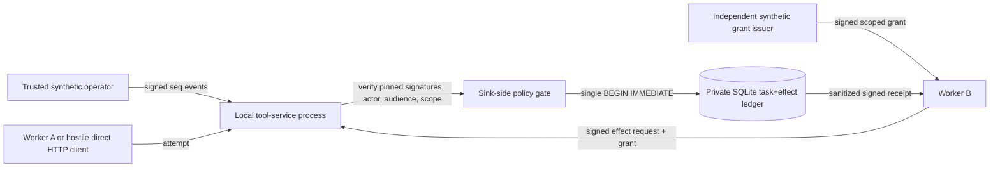

# Independent synthetic tool-effect service (v0.1, issue #102)

**Status:** new research implementation and adversarial test fixture; **not** a production tool gateway, a host sandbox, a global policy decision point, or an exactly-once distributed protocol. Synthetic/public data only; HTTP is bound to loopback without TLS. The service has its **own SQLite ledger**, keys and authority configuration. [Issue #50](https://github.com/MSKazemi/agent-movement/issues/50) remains open for all-enabled-path mediation.

## Research question

Can a simulated external tool service, *operating in a separate process rather than executing a Python callback in the agent process*, independently verify an authorized worker, time-bounded issuer grant, currently assigned task owner, epoch, policy and budget **inside the same target-side transaction as its simulated effect**? How do direct forged calls, stale workers, revoked grants, replay, request loss and restarts differ?

**Claim:** The separately provisioned sink checks this narrow contract on the **explicitly enabled /v0/effects endpoint**, using a server-owned SQLite write transaction. A bypassing client cannot turn its own unsigned fields into authority at this sink under honest-key, honest-kernel, uncompromised-service/DB and trusted-clock assumptions. Other adapters, other processes and real APIs remain outside this claim.

## Diagram: actual control and trust boundary



Trust anchors, the service receipt-signing key, worker verifier keys, operator verifier key, own budget and service ID are loaded from an **operator-owned, owner-only file** before the listener starts. No agent HTTP call can install these. The service accepts only the two versioned endpoints; no general network proxy, shell/command, raw text body, arbitrary tool parameters or read/administration endpoints exist. The test runner uses disposable **HS256 keys**. Because HS256 is symmetric and tests run under one Unix UID, this does *not* establish independent organizations, confidential transport or filesystem separation.

## Contract and data minimization

The API is **separate** from the package's proposed `0.2.0-draft` handoff envelope; the independent experimental service has integer `version: 1`. It **does not** silently claim to implement the canonical handoff schema.

- `POST /v0/operator`: one purpose-separated signature of `tool-operator-event` from a separately configured trusted operator. Events have exact allowlisted keys and monotonically increasing **per-task** `seq` numbers. `enroll` validates an issuer-signed grant scoped to worker B, this **tool-service audience**, task, capability and synthetic classification; stores its server-keyed binding; sets initial owner A and epoch 1. `transfer` checks the prior owner and epoch and atomically moves ownership to B, epoch 2. `revoke` requires a separately issuer-signed grant revocation bound to the enrolled grant. `policy_rollover` increments the policy epoch and creates a conservative **unknown/reconcile hold**; `mark_unknown` persists the hold. No automatic clearance or resurrection is implemented.
- `POST /v0/effects`: exact object with `version`, `operation: synthetic_effect`, a purpose-separated `tool-effect-request` signed by the pinned worker key, and an independent issuer-signed `grant`. The signed request binds `movement_id`, `task_id`, `actor_id`, `service_id`, `kind`, `classification`, `policy_epoch`, `owner_epoch`, `effect_id`, `effect_tag`, unit `cost`, and `grant_digest`. The `effect_tag` is a 64-hex synthetic commitment **not raw task text**.
- At the **target**, inside `BEGIN IMMEDIATE`, the service checks enrolled task, active transfer, current owner/epoch, capability, destination, movement, epoch, issuer grant binding, time validity, revocation, unknown hold, idempotency collision and budget **before inserting a simulated effect**. A copied signature or an expired grant cannot bypass the target's current revocation/epoch state. New effects exhaust budget atomically, while exact retries are deduplicated.
- Every processed operator/effect request returns a **signed `tool-effect-receipt`** with only status, kind, task/effect IDs and service identity (no grant, key, payload or task text). Statuses: `applied` (operator), `committed`, `replayed`, `denied`, `conflict`, `unknown`. Malformed HTTP framing is rejected before trusted processing. Only a verifier supplied out-of-band with the pinned receipt key can independently authenticate a response; the service cannot prove that its own logs are complete or truthful against host compromise.
- The private SQLite `tool_events` ledger stores only category/outcome and optional IDs; `tool_effects.request_binding` and the enrolled grant binding are **HMAC commitments keyed by the service store**, not task text, low-entropy raw hashes or transferable grant credentials.

**Loss of reply:** A client that sent a request but has no verified response must report `unknown to client`, not `failed`. The test deliberately closes a connection after sending a request; an independent SQLite read finds whether an effect committed; retrying the *identical authorized request* yields `replayed` if it did. This is **at-most-one simulated write for one effect ID in one ledger**, not end-to-end exactly-once behavior. Without independent outcome evidence, `mark_unknown` leaves a conservative hold. The service never fabricates a resolution for uncertain real effects.

## Reproducible experiments

```sh
python -m pip install -e . 'pytest>=9.1'
python -m pytest -q tests/test_tool_effect_service.py
python -m agent_movement.tool_effect_service --help
python -m pytest -q
make lint typecheck
```

Tests create ephemeral owner-only config files and keys, run a **real localhost server in a different OS process**, issue independent operator and worker signatures, send raw HTTP bypassing any official peer client, verify signed receipts and inspect the sink's own SQLite DB. The matrix includes:

- Positive owner transfer, one authorized commit, exact retry, one-budget-accounting;
- forged/missing worker signatures, false `approved` flags, extra fields and unsupported operations;
- wrong audience, actor, task, capability, classification, issuer, service ID, grant, movement, epoch, policy version and budget;
- expired/not-yet-valid grants, revocation after commitment, policy rollover, suspended/uncertain tasks, replayed/tampered operator sequences;
- concurrency across eight HTTP calls, effect-tag collision, service crash/restart, deliberately lost HTTP response;
- **red/green mutation:** skip the target's epoch check in a test-only local object and show a stale signed request that was refused under the real sink can then commit. The weakened function is never enabled in the service entrypoint.

The dedicated CI workflow runs the focused process tests; the normal package CI covers the same tests in core and optional-extra Python matrices.

## Limitations and acceptance boundary

- A separate **process and private DB** provide an independent authorization *decision location*, not independently privileged host containment: the synthetic parent/operator and service have the same OS UID, and a malicious process with filesystem access to service keys/DB could bypass them. Tests establish **HTTP API** mediation, not arbitrary local writes, same-UID `/proc` or inherited-FD security.
- Operator and issuer are modeled independently **logically** but use synthetic HS256 credentials. Compromised signing keys, issuer, operator, kernel, SQLite path or wall clock invalidate the conclusion. No credential rotation, root-of-trust management, authenticated OS user or remote attestation is implemented.
- The tool service's versioned request is purposely **not** another way to deploy, clone, install or relocate an agent; it accepts neither executable code nor external tool arguments. No real money, deletion, API changes, private records or physical effects.
- Policy changes are conservative holds, not automatic approval migration. Operator events cannot override withheld human consent automatically; multi-principal obligations must be verified by an independent upstream runtime before issue. A signed operator event does not prove its issuer actually had human consent.
- `/v0/operator` is protected by a pinned signature and increasing sequence, but network transport is plaintext loopback. No transport-level source authentication, HTTP confidentiality, rate limiter, authenticated IPC or independent sink audit storage.
- A timeout, unreachable service or lost reply is **unknown**, not evidence of an effect that did not occur. Third-party APIs remain entirely outside this ledger's atomicity.
- This research slice does not globally disable the legacy HTTP, A2A, peer, model runtime or unguarded effect gateways. Those remain **out of the narrow claim** under [issue #50](https://github.com/MSKazemi/agent-movement/issues/50).

**Follow-on:** Integrate this target-side service only through a named secure-test profile that separately inventories and disables/allows origin, receiver, effect, filesystem and egress routes. Then test multi-principal trusted provisioning, real revocation distribution and split-host failure assumptions independently; do not promote these synthetic outcomes into production guarantees.
