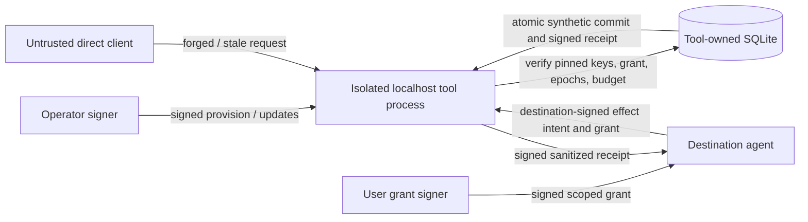

# Independent synthetic tool-side enforcement (issue #102)

**Status: bounded proof-of-concept.** The agent's Python runtime is not trusted to approve its own protected effect. The tool service runs as a **separate OS process** with an independently provisioned issuer-verification configuration, destination signing key, operator key and private SQLite effect ledger. This is not deployment-ready authorization, independent OS-user isolation, general device/network containment, or an external effect gateway.

## Trust boundary and data flow



The independent service owns the **commit point**. Agent-supplied `approved: true`, arbitrary IDs or an unverified sender-side callback cannot authorize an effect. Its operator-provisioned authority record fixes `task_id`, `movement_id`, grant digest, source and destination, action/capability, data classification, named synthetic resource, policy and ownership epochs, expiry, and finite budget. This configuration is not accepted in an ordinary effect request.

- Signed operator `/v0/tool/provision` (first write only), `/v0/tool/update` (monotonic policy/epoch change, sticky revocation), separately signed by the operator key pinned at service startup.
- Signed executor `/v0/tool/effects` checked against the destination verifier pinned at service startup. The service independently verifies the issuer-signed *scoped* grant, exact grant digest, required task/audience/source/kind/classification, owner and policy epochs, liveness/revocation and effect budget. It then commits one synthetic effect row in a single SQLite `BEGIN IMMEDIATE` transaction. Duplicate IDs with identical signed bodies replay the recorded receipt; conflicting bodies refuse.
- Signed executor `/v0/tool/query` returns a tool-signed previous receipt or `unknown_reconcile`. **A missing ledger row cannot prove that an in-flight request will never arrive**, and neither a disconnected client nor a missing HTTP response may assert an effect did not happen.
- Only a 64-hex synthetic payload commitment is accepted; no task text, provider keys, raw credentials, memory or personal data should be included. No real tool, purchase, device actuator or external network is invoked.

## Run the two-process experiment

From repo root on Python 3.11+:

```sh
python -m pip install -e . pytest
python -m pytest -q tests/test_tool_service.py
```

The regression fixture creates disposable test issuer/operator/destination/tool keys, provisions the tool service through a private `0600` temporary config, starts a **second Python process** bound to `127.0.0.1` on an ephemeral port, exercises direct HTTP requests and independently reopens the SQLite ledger for committed effect counts. The fixture runs in dependency-free HS256 mode and, if `cryptography` is installed, repeats with Ed25519 asymmetric signing. All sensitive strings are synthetic canaries and discarded.

**Do not use the test `0600` provisioning file as a production secret store.** Same-UID processes may read each other's files or memory under many host configurations; this two-process experiment is not the stronger distinct-unprivileged-UID sandbox in [#98](https://github.com/MSKazemi/agent-movement/issues/98).

## Negative/positive conformance cases

| Case | Expected at tool boundary | Independent evidence |
| --- | --- | --- |
| Valid signed scope, correct owner+policy epoch | COMMITTED | Signed receipt and 1 tool_effects row |
| Duplicate signed request | REPLAYED | Same receipt, still 1 row |
| Same ID, changed commitment | CONFLICT | No extra row |
| Direct unsigned / rogue-signed request | UNAUTHENTICATED | No row |
| User grant signed by untrusted issuer | UNAUTHENTICATED | No row |
| Wrong recipient or resource | FORBIDDEN | No row |
| Stale owner epoch before and after signed update | FORBIDDEN | No row |
| Stale policy after signed update | FORBIDDEN | No row |
| Operator key forgery | UNAUTHENTICATED | No policy mutation |
| Signed operator revocation | FORBIDDEN for future effects | Transactional sticky revoked flag |
| Parallel identical retries | 1 COMMITTED, all others REPLAYED | One SQLite row and budget consumed once |
| Budget exhausted | FORBIDDEN for a new effect | No new effect row |
| Client discards successful reply | UNKNOWN to client until queried | Query returns independently signed original |
| Deliberately remove the epoch check (mutation red control) | **Unsafe commit observed** | Test demonstrates which gate is necessary |

The red-green mutation is scoped to an in-process `unittest.mock.patch` of a testing reference, never an HTTP-toggleable production feature. If the normal current-epoch refusal regression were run on the mutated implementation, it would fail; this is not a complete fault injection of a hostile operator or kernel.

## Limitations and precise claim

The test establishes that *for one service instance*, when keys, operator decisions, code, clock and SQLite file are trusted, the listed signed requests and state transitions are enforced at the independent **synthetic** effect ledger. It does **not** establish that all channels are mediated, that the agent cannot leak a canary via a different network interface, that the destination is genuine beyond possession of its key, that all remote effects have exactly-once semantics, or that revocations propagated over a partition have arrived. Linux UID separation, trusted hardware, other tool services, policy signer compromise and coordinated effects across multiple databases remain unproven.

The `tool-authority` record is a host-local trust source, not a continuously queried distributed source. Operators must reconcile it against any external coordinator before making a security claim. An operator can legitimately provision/advance epochs or revoke grants; access to that signing key is out of the agent's privilege set **only under a separately enforced host trust assumption**.

**Follow-up:** [#50](https://github.com/MSKazemi/agent-movement/issues/50) and [#99](https://github.com/MSKazemi/agent-movement/issues/99) must enumerate and disable bypasses in A2A, legacy HTTP and raw agent tool paths. [#98](https://github.com/MSKazemi/agent-movement/issues/98) must independently isolate process credentials/filesystem/network. [#103](https://github.com/MSKazemi/agent-movement/issues/103) still needs a signer-verified destination activation barrier for the guarded authority runtime. The tool-side experiment does not resolve those issues.
