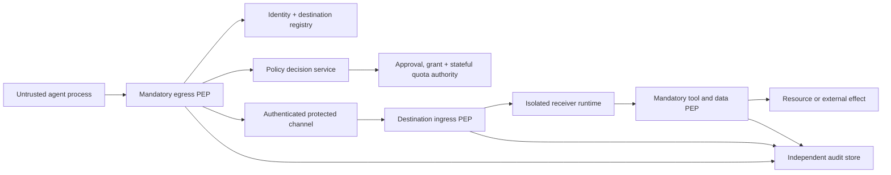

# Agent Movement Rules: policy, enforcement, and assurance

**Status (2026-10-15):** Research proposal plus a small **decision-only, synthetic** Python prototype. This is **not** a production security gateway, an approved standard, a verified protocol, or proof of safe agent movement. We use **Agent Movement Security Protocol (AMSP)** only as a suggested project working name, not as an existing standard.

## Short answer: where do guarantees come from?

Instructions such as "agent must never clone itself" are **not security boundaries**. A language model can suggest actions, but an **independently controlled policy enforcement point (PEP)** must gate every protected capability. A **policy decision point (PDP)** can answer allow/deny; it does not itself prevent an unmediated network connection, process spawn, database read, or tool invocation. NIST SP 800-207 describes PDP/PEP boundaries, and OPA's documentation explicitly separates the decision engine from the tool-call harness that must enforce the decision [1, 2].

Define a claim narrowly:

> If **all movement and side-effect channels are mediated** by correctly implemented and uncompromised enforcement points; workloads lack alternative network, storage, credential, and execution paths; the identity/policy/approval inputs are trustworthy; and stateful limits are enforced atomically, then forbidden transitions through those controlled interfaces can be blocked by policy.

That conditional statement is **not** a universal guarantee about arbitrary AI agents or third-party systems. It does not hold if the host, identity issuer, tool server, or egress controls are compromised, or if an external system already received data and can copy it. An audit log cannot establish that an unobserved action did not happen.

## What must be controlled?

An agent's "movement" may be a `delegate` message, checkpoint `relocate`, copy/`clone`, `fork`, `replicate`, `fan_out`, artifact export, remote code execution, or the use of a remote tool that transfers data. Blocking an A2A handoff alone is not sufficient: an agent with shell, web, storage, or tool privileges might make the same transfer through a different route.

A **movement authorization** must be bound to *all* relevant dimensions, not just the name of an agent:

- **Who:** authenticated originating workload and intended destination identity, not an agent's self-declared name.
- **What:** exact operation, content digest/approved payload class, schema version, allowed checkpoint type and destination runtime.
- **Where:** trusted registry/attested destination, geographic region and organization/trust domain.
- **Which authority:** user or delegated grant, explicitly narrowed scopes, token issuer, recipient audience, expiry, policy digest and revocation state.
- **How far:** maximum hop depth, children/replicas, tool scopes, network destinations, CPU/time/cost and retention.
- **Which effects:** read-only vs irreversible actions; verified independent user approval for sensitive operations and effects.
- **When:** a unique movement/operation ID, replay window, current authorized task owner and monotonic fencing epoch for relocation.

The origin must **never** copy its reusable OAuth tokens, private keys, cookies, or ambient permissions into the envelope. Use purpose-bound, short-lived delegated authority with sender constraints when supported (see RFC 8693 and RFC 9449) [4, 5].

## Proposed normative rules (AMSP draft, not adopted standard)

| ID | Draft rule | Non-agent enforcement location | Required independent evidence |
| --- | --- | --- | --- |
| AMR-01 | Deny by default on missing, unknown, conflicting, or unverifiable fields | Egress and ingress PEP | Schema, policy version/digest, decision receipt |
| AMR-02 | No movement to an unapproved destination | Egress network control, movement gateway, ingress PEP | Authenticated receiver identity plus approved registry entry |
| AMR-03 | Never inherit the origin's broad credentials | Token issuer, secrets broker and tool gateway | Verified scope, audience, subject, operation, expiry, key binding |
| AMR-04 | No prohibited private data may leave its trust/residency boundary | Data store/export gate, DLP and egress PEP | Verified data class and actual payload/content inspection |
| AMR-05 | Every new hop must be authorized independently | Both movement gateways and grant issuer | Parent lineage, grant attenuation, verified hop count |
| AMR-06 | Clones/forks/replicas require a separately minted authorization | Workload scheduler, process and image admission | Unique child ID, approved count and *atomic* quota reservation |
| AMR-07 | High-risk operations require explicit, specific approval | Independent human approval service + tool PEP | Approval bound to movement, origin, destination, operation and effect |
| AMR-08 | No unauthorized runtime or image may execute | Workload scheduler, image verifier, optionally attestation gate | Trusted artifact digest/provenance and runtime measurement |
| AMR-09 | Resource and spend budgets cannot be exceeded | Quota authority, scheduler, API/tool billing gateway | Atomic reservation and metered usage, not agent declarations |
| AMR-10 | Expired/revoked grants cannot authorize **new** effects | Ingress and resource/tool PEP | Current verifier time and authoritative revocation status |
| AMR-11 | Relocation cannot create two concurrent authorized effect writers | Coordinator + effect service | Monotonic fencing epoch and durable ownership/intent record |
| AMR-12 | Network partition, outage or uncertain side effect must fail closed | Egress, ingress and effect PEP | Durable reconciliation status (`unknown` != `failed`) |
| AMR-13 | All controlled movements have independent evidence | Gateway, tool service, append-only evidence store | Paired decision/dispatch/acceptance/effect receipts with integrity checks |
| AMR-14 | Policy and approval are not agent-editable | Protected policy store, build/runtime configuration, IAM | Verified policy digest, reviewed releases and protected permissions |

**Caveats:** A "verified" data label is only as good as the classifier/DLP boundary and the actual bytes inspected. An agent-supplied region, hop count, or `approved: true` field is **not** evidence. Runtime attestation (RFC 9334) is an optional way to appraise a device's measured state, **not** evidence that an LLM will behave ethically or never make mistakes [6].

## Reference architecture: enforcement is outside the model



**Required deployment properties:** deny direct egress except to an authenticated gateway; deny arbitrary destination ingress; do not mount reusable secrets into untrusted agents; constrain process/shell/network access at the OS/container/hypervisor layer; enforce tool permissions and data accesses at the **resource** side as well as the dispatch side. Kubernetes NetworkPolicy can contribute to isolation, but it requires a supporting network plugin and does not replace application-layer authorization [7]. Apply restrictions to DNS, service discovery, storage paths, RPCs, background jobs, browser sessions and subprocesses, not only A2A/MCP messages.

For multi-organization transfers, the receiving organization must independently enforce constraints. If the recipient is not within a mutually verifiable and enforceable trust arrangement, reduce the data/privileges disclosed or **refuse the movement**.

## Draft preflight decision formula

For a proposed movement `m`, **all** relevant predicates must hold:

```text
PERMIT(m) =
  AUTHENTICATED_ORIGIN(m)
  AND AUTHENTICATED_DESTINATION(m)
  AND DESTINATION_ALLOWED(m)
  AND OPERATION_ALLOWED(m)
  AND ACTUAL_DATA_AND_REGION_ALLOWED(m)
  AND GRANT_VALID_AND_BOUND_TO_MOVEMENT(m)
  AND REQUESTED_SCOPES_SUBSET_OF_GRANT_AND_DESTINATION(m)
  AND APPROVAL_PRESENT_WHEN_REQUIRED(m)
  AND HOP_AND_GLOBAL_QUOTAS_RESERVED(m)
  AND REPLAY_CHECK_ATOMICALLY_PASSED(m)
  AND FENCE_VALID_IF_RELOCATING(m)
  AND POLICY_CURRENT_AND_SIGNATURE_VALID(m)
```

Missing predicate, verification failure, or unavailable critical service => **DENY/QUARANTINE**, never an implicit allow. A preflight permit is **not a transferable blanket permit** to perform any later action: every tool-side effect must still be authorized under current constraints.

## Reference code included in this repository

- [`examples/movement-policy.v0.json`](../examples/movement-policy.v0.json): narrow synthetic allowlist for one local reviewer.
- [`tools/movement_policy.py`](../tools/movement_policy.py): standard-library-only **pure decision function** evaluating strict request shape and verifier-produced facts.
- [`tests/test_movement_policy.py`](../tests/test_movement_policy.py): synthetic permission, denial, approval-scope and failure cases.

Run from repository root:

```bash
python -m unittest discover -s tests -v
```

The sample permits one `delegate` transition, to one specific reviewer, for data no more sensitive than `public`, with one requested capability (`artifact.read`), a one-hop limit, **zero** new instances, bounded execution/budget and an independently verified, operation/audience/movement/policy-digest-bound grant. The default policy **does not permit cloning, relocation, replication, forking, or fan-out**.

The `facts` argument is a **test stub for the trusted computing base**. In real deployments it must be constructed by authenticated registries, token/signature verifiers, content classifiers, approval services, authoritative coordinators and the server clock. **Never accept `facts` from the agent request, messages, LLM outputs, tools, or destination's self-assertions.** The sample `grant_signature_valid: true` in tests is an invented fixture, not an actual signed credential. The JSON digest uses a local deterministic representation; production cross-language signing needs an explicitly specified canonicalization and signature format.

**Not implemented here:** cryptography/token parsing, actual network PEP/egress control, A2A/MCP adapter, payload scanning, replay ledger, durable quorum/quotas, fencing, runtime attestation, real approval UI, audit anchoring and incident recovery. The prototype must **not** be deployed as a security boundary, even though the decision tests pass. A real service should capture exceptions and deny on errors, use bounded inputs, and be checked independently.

## Assurance and evidence: what can we actually prove?

| Assurance tier | Evidence | Scope of claim |
| --- | --- | --- |
| L0 — prompt-level | Natural-language instructions | No meaningful technical non-bypassability |
| L1 — policy logic | Schema tests, decision unit tests, negative cases | Evaluator denies selected synthetic inputs |
| L2 — mediated runtime | Authenticated gateway, sandbox isolation, tool/data PEP, egress controls, integration tests | Forbidden operations blocked through measured protected channels |
| L3 — resilient distributed control | Durable quota/replay records, state-machine model checking, fencing, chaos tests, independent receipts | Tested invariants under specified crashes, retries and network partitions |
| L4 — high-assurance deployment | Measured-boot/attestation where appropriate, audited trusted computing base, supply-chain verification, systematic adversarial review | Stronger **conditional** assurance for a precisely stated threat model, not a universal promise |

Security must be evaluated both as **prevention** (was the forbidden effect blocked by a mandatory PEP?) and **detection** (can we independently determine what happened?). A policy denial log alone is insufficient if a different interface can perform the same action. Forensics should preserve `unknown` when coverage is missing; see [agent-forensics-and-fingerprints.md](agent-forensics-and-fingerprints.md).

## Adversarial and fault-injection matrix (next-phase acceptance)

1. **Bypass paths:** try direct HTTP/DNS, file-sharing, browser, shell, unapproved MCP tool and direct A2A peer; **all** should fail independently of model obedience.
2. **Forged authorization:** wrong source/receiver, audience, scope, operation, movement ID, policy digest, stale/expired/revoked signature, tampered approval.
3. **Payload masking:** secret canaries hidden in ostensibly public text, attachments, encoded text, URLs and artifact references; block at *actual data* export point.
4. **Transitive movement:** A->B->C; B must not inherit A's grant, hop count must be derived from trusted lineage; no grant or quota amplification.
5. **Concurrent fork/clone:** many workers race on the last quota; use one transactional reservation, not stateless preflight checks.
6. **Fencing:** delayed A and active B both attempt an effect after relocation; the effect service must reject stale A's epoch.
7. **Network partition:** coordinator, approval service, clock and revocation backend become unavailable; protected actions are blocked and incident state remains `unknown/reconcile` where appropriate.
8. **Audit gaps:** drop/forge client spans; compare independent egress, ingress and resource logs. No evidence means *unknown*, not proof of no movement.

**Success criteria:** zero committed forbidden actions in the defined adversarial/fault-injection suite; quantified coverage of *all privileged effect channels*; no raw secrets in movement envelopes or decision logs; executable test traces and precisely scoped proof obligations. "Zero violations in tests" is not a statistical guarantee of zero real-world risk.

## Important open research questions

- **Complete mediation theorem:** How can we automatically discover and verify *every* alternate data/export/compute path, including future tools and browser automations?
- **Cross-domain enforcement:** How can two independently operated organizations agree on a policy, verify each other's evidence, and refuse transfers safely when they disagree?
- **Proof-carrying handoffs:** Can each movement carry a verifiable certificate of *which rules were checked and by whom*, without leaking policy details or assuming signed statements prove actual behavior?
- **Distributed authority:** Can we formally specify (TLA+/PlusCal/Alloy) no unauthorized double writer, bounded descendants, attenuation of grants and safe fail-closed transitions under partitions?
- **Semantic safety:** How do we validate that a transferred checkpoint or learned instruction does not quietly introduce a new intent that evades metadata-level policy?

## Immediate implementation sequence

1. **Write proof obligations and threats** for one *public synthetic* local delegation (this document and the basic checker).
2. Implement real ingress/egress tool PEPs on an isolated two-worker testbed; block direct network, shell and storage movement paths.
3. Replace `trusted_facts` fixtures with authentic verifiers (mTLS/SPIFFE-style workload identity, short-lived sender-constrained grant, signed approval and independent data-classification service).
4. Add transactional replay prevention, global quotas, per-tool validation, revocation rechecks, append-only receipts and incident reconciliation.
5. Model-check relocation fencing before enabling real `relocate`, `clone`, `fork`, `replicate` or `fan_out` operations.
6. Publish red-team scenarios, all failures, the trusted computing base and *bounded* assurance claims.

## References (verified external specifications)

1. NIST SP 800-207, **Zero Trust Architecture**: https://nvlpubs.nist.gov/nistpubs/specialpublications/NIST.SP.800-207.pdf
2. Open Policy Agent, **Agent Tool Calling** (PDP vs harness PEP): https://www.openpolicyagent.org/docs/agent-tool-calling
3. SPIFFE, **Identity and Verifiable Identity Document**: https://spiffe.io/docs/latest/spiffe-specs/spiffe-id/
4. IETF RFC 8693, **OAuth 2.0 Token Exchange**: https://www.rfc-editor.org/rfc/rfc8693
5. IETF RFC 9449, **OAuth 2.0 DPoP**: https://www.rfc-editor.org/rfc/rfc9449
6. IETF RFC 9334, **Remote Attestation Procedures (RATS) Architecture**: https://www.rfc-editor.org/rfc/rfc9334.html
7. Kubernetes **NetworkPolicy** (requires enforcement-capable CNI): https://kubernetes.io/docs/concepts/services-networking/network-policies/
8. OWASP, **Top 10 for Agentic Applications 2026**: https://genai.owasp.org/resource/owasp-top-10-for-agentic-applications-for-2026/