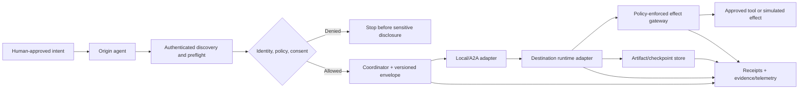

# Repository structure review and incremental architecture proposal

**Review date:** 2026-10-16  
**Scope:** `main` plus visible open work as of this review. This is an architectural proposal, not a claim of implemented capabilities or a decision to reorganize files.  
**Status:** Proposed for review. Do not treat this document as a published protocol specification.

## Executive recommendation

Develop **Agent Movement** as a research-and-engineering platform for **safe, verifiable movement of agent work** across execution boundaries, rather than a new transport protocol or an unbounded self-replicating agent system.

Organize around **three independently reviewable products**:

1. **Research and standards evidence:** literature/news corpora, device and standards catalogs, hypotheses, threat models and falsifiable research questions.
2. **Reference implementation:** language-neutral versioned transfer contracts; policy and identity checks; lifecycle/ownership; transport and runtime adapters; artifacts and auditable evidence.
3. **Reproducible evaluation:** protocol conformance, security/fault-injection scenarios and MobilityBench comparisons with clearly stated limits.

**Do not move the existing news/paper corpora immediately.** Their stable `AMN-`/`AMP-` identifiers, generated-file build paths, citations, README links and deterministic quality gates should be preserved. Prefer a navigation index before a disruptive docs relocation.

## 1. What exists, and what is pending

Snapshot observed on `main`:

- Top level: `.github/`, `data/`, `docs/`, `tests/`, `tools/`, `README.md`, `Makefile`, `pyproject.toml`, `CITATION.cff`.
- Research material includes working definitions, forensics, device capabilities, open questions, security, standards, source indexes and roadmaps.
- Curated corpora: `docs/news-corpus/` (100 news items) and `docs/paper-corpus/` (83 papers, per their committed README snapshots), plus generated analysis/QA.
- `tools/` contains corpus and link-analysis scripts; `tests/` covers these research pipelines; CI currently checks corpus reproducibility and tests.
- **No `src/` executable mobility package is present on `main`.** README correctly labels the repository research/design only. Do not describe a working mobility runtime as already released.
- `pyproject.toml` on `main` currently configures test dependencies, not a distributable mobility SDK.
- There is **no LICENSE file** on `main`; choosing usage rights is an explicit maintainer decision, not a restructuring step.

Important in-flight work:

| Work | Observed status | Architectural implication |
| --- | --- | --- |
| [PR #6](https://github.com/MSKazemi/agent-movement/pull/6) local handoff | Open, introduces `src/agent_movement/{core,http,demo}.py`, synthetic SQLite receipts/fencing, tests; GitHub reported `mergeable_state: dirty` during this review | Treat as experiment 001 and future package nucleus **after conflicts are resolved**; do not present as authenticated/A2A/real checkpoint movement |
| [PR #14](https://github.com/MSKazemi/agent-movement/pull/14) 20-case smoke | Open, **stacked on PR #6 branch**, not `main` | Review/land #6 first; maintain clear `known_gap` verdicts; do not conflate smoke cases with full MobilityBench |
| [PR #3](https://github.com/MSKazemi/agent-movement/pull/3), [#4](https://github.com/MSKazemi/agent-movement/pull/4), [#5](https://github.com/MSKazemi/agent-movement/pull/5) | Open architecture/language/research/protocol documentation | Reconcile overlap into architecture decisions and one docs index, not competing reference designs |
| [PR #2](https://github.com/MSKazemi/agent-movement/pull/2), [#12](https://github.com/MSKazemi/agent-movement/pull/12), [#13](https://github.com/MSKazemi/agent-movement/pull/13), [#15](https://github.com/MSKazemi/agent-movement/pull/15) | Open source/documentation/security/research proposals | Consolidate terminology and navigation before renaming these documents |

Open implementation/research issues: [#7 A2A](https://github.com/MSKazemi/agent-movement/issues/7), [#8 identity/pre-disclosure](https://github.com/MSKazemi/agent-movement/issues/8), [#9 checkpoint relocation](https://github.com/MSKazemi/agent-movement/issues/9), [#10 MobilityBench](https://github.com/MSKazemi/agent-movement/issues/10), [#11 evidence/receipts](https://github.com/MSKazemi/agent-movement/issues/11).

This is a snapshot; PR mergeability and status can change. Verify again before sequencing merges.

## 2. Recommended logical component boundaries

Use these components as **interfaces**, not as a requirement to instantiate a microservice or Python package for each immediately.

| Component | Owns | Must not own |
| --- | --- | --- |
| **Contracts / schemas** | `movement_id`, logical task, execution/lineage IDs; envelope and receipt versions; validation and compatibility | Authenticated trust decisions or running arbitrary tasks |
| **Identity / discovery** | Verified origin and destination principals; allowlisted capabilities and signed/verified assertions where appropriate | Treating Agent Cards or claimed IDs as proof of identity |
| **Policy / approval** | Data classification, recipient/audience, time-bound grants, revocation, human approval and pre-disclosure deny | Copying origin credentials or authorizing from prompt text alone |
| **Movement coordinator** | State transitions, exclusive ownership/fencing for relocation, retries, cancellation, reconciliation | Claiming exactly-once execution of uncontrolled external tools |
| **Transport adapters** | A2A framing and optional local synthetic transport; typed conversion to/from the project envelope | Redefining A2A or embedding policy in a transport serialization |
| **Runtime adapters** | Safe checkpoint export/import at documented compatible boundaries (first same-runtime) | Exporting arbitrary model hidden state, raw secrets or in-flight external side effects |
| **Artifact/checkpoint storage** | Content digest, version, retention, access policy, durable references | Treating an artifact checksum as proof of authorship |
| **Receipts / evidence** | Verifiable lineage, source and receiver attestations, independently checkable audits, sanitized telemetry | Treating self-reported logs as cryptographic proof |
| **Effect gateway** | Scoped tool calls, cooperative epoch check, side-effect idempotency where supported, `unknown/reconcile` handling | Assuming third-party tools are transactionally fenced |
| **Benchmarks / experiments** | Frozen fixtures, baseline runners, attack/fault injection, reproducible manifests, measured results and known gaps | Inflating a demo/test pass count into broad scientific or security assurance |

The independent policy enforcement point should run **before sensitive payload transfer** and again **at every side-effect boundary**. Cross-machine deployment must remain disabled by default in test examples unless authenticated, explicitly authorized and isolated.

## 3. Target structure (incremental; illustrative)

Directories marked `[later]` are **proposals**, not currently present or required for the first PR.

```text
agent-movement/
├── README.md                     # stable public project entry point
├── CITATION.cff
├── pyproject.toml                # future SDK packaging + dev/test dependencies
├── Makefile
├── .github/
│   └── workflows/
│       ├── corpus.yml           # existing research reproducibility
│       ├── python-package.yml   # [later] SDK/tests/type and package smoke
│       └── security.yml         # [later] focused security checks
├── docs/
│   ├── index.md                 # [first] reading paths and status labels
│   ├── proposals/
│   │   └── 2026-10-16-repository-structure.md
│   ├── decisions/               # [later] ADRs: scope, language, IDs, auth
│   ├── architecture/            # [later] boundaries, lifecycle, threat model
│   ├── specifications/          # [later] draft envelope, policy and receipt profiles
│   ├── research/                # [later] synthesis, gaps, experiment hypotheses
│   ├── news-corpus/             # KEEP paths and stable published AMN IDs
│   ├── paper-corpus/            # KEEP paths and stable published AMP IDs
│   ├── corpus-analysis/         # KEEP reproducible outputs
│   ├── corpus-qa/               # KEEP provenance and link-health reports
│   └── *.md                     # existing documents; migrate only with links
├── data/                        # existing device, standards, evidence CSVs
├── schemas/                     # [later] canonical versioned JSON Schemas
│   └── v0/
│       ├── movement-envelope.schema.json
│       ├── policy-decision.schema.json
│       ├── checkpoint-manifest.schema.json
│       └── receipt.schema.json
├── src/agent_movement/           # PR #6 proposed starting point
│   ├── __init__.py
│   ├── contracts/               # [later] Python validators of schemas/
│   ├── identity/                # [later] authenticated peer claims
│   ├── policy/                  # [later] approvals and revocation
│   ├── coordinator/             # [later] state, fencing, reconciliation
│   ├── transports/
│   │   ├── local.py             # [later] synthetic local adapter
│   │   └── a2a.py               # [later] official SDK integration
│   ├── runtimes/                # [later] named, version-pinned adapters
│   ├── storage/                 # [later] checkpoints/artifacts
│   ├── evidence/                # [later] audit/receipts/verifier
│   └── demo.py                  # initial smoke entry point (PR #6)
├── experiments/                 # [later] numbered, isolated experiment manifests
│   ├── 001-local-handoff/
│   ├── 002-a2a-two-workers/
│   └── 003-checkpoint-relocation/
├── benchmarks/                  # [later] MobilityBench with explicit baselines
│   └── mobilitybench/
│       ├── protocol.md
│       ├── fixtures/
│       ├── baselines/
│       ├── metrics/
│       └── results/             # tracked summaries, not secrets/raw run dumps
├── examples/                    # [later] safe local demos only by default
├── tests/                       # keep existing tests; add categories gradually
│   ├── unit/                    # [later]
│   ├── integration/             # [later]
│   ├── security/                # [later]
│   ├── fault_injection/         # [later]
│   └── conformance/             # [later]
└── tools/                       # KEEP reproducible corpus scripts and QA
```

**Do not create all folders now.** A component should become a separate module only when it has a stable public contract, independent test responsibility or genuine implementation complexity. The `core.py` experiment in PR #6 can be split *after* it merges and behavioral regression tests are green. Do not rename corpus paths just to make the tree look neat.

## 4. How the parts fit together



Separate **delegation**, **portable context transfer**, **same-runtime checkpoint relocation**, and **cross-framework reconstruction** as independently testable profiles. Never use `move`, `copy` or `clone` as synonyms without specifying identity, lineage, and authority rules.

## 5. Dependency-aware adoption plan

### Step 0 — Protect current research foundations (no large moves)
- Add a concise `docs/index.md` entrypoint later; clearly label every link as *research*, *specification draft*, *working experiment*, or *benchmark result*.
- Keep the published corpus paths, `AMN`/`AMP` IDs, citations and `make check verify-determinism verify-analysis test bib` behavior intact.
- Consolidate conflicting material from open documentation PRs through review, not through blind bulk renames.
- Record unresolved decisions (project scope, Python-first strategy, envelope ownership, checkpoint limitations, security gates, licensing) in proposed ADRs.

### Step 1 — Land narrow execution proof safely
- Rebase/resolve PR #6's reported conflicts against current `main`; re-run its local demo, tests and corpus gates before merge.
- Preserve explicit limitations: loopback only, claimed IDs not authenticated, receiver-side approval after disclosure, cooperative simulated fencing only, not official A2A.
- Then update/rebase stacked PR #14 and label its `known_gap` outcomes as missing controls rather than passes.

### Step 2 — Secure the boundary and adopt existing protocol
- Implement authenticated identity, recipient capability/policy negotiation and **pre-disclosure** authorization (#8).
- Integrate official A2A v1 SDK with independent agents (#7), keeping transport and application-level contract separate.
- Publish and validate a first canonical schema with negative compatibility/security fixtures. Add package CI; pin tested versions.

### Step 3 — Prove continuity, not just delivery
- For #9, use one pinned durable runtime and a safe exportable application checkpoint; transfer exclusive task ownership; crash/restart/partition tests and reconcile ambiguous effects.
- For #11, distinguish self-reported traces, signed receipts and independent tool-side corroboration, with an offline verifier.

### Step 4 — Publish independent evaluation
- For #10, compare keep-on-origin, restart, delegate, same-runtime relocate and optional cross-framework reconstruct under frozen fixtures.
- Report task correctness, preserved constraints, duplicates, policy violations, unknown outcomes, payload, latency, cost, crash recovery and evidence quality.
- Make negative findings reproducible. Only then consider a second runtime/language, remote trust domains and hardware/device profiles.

## 6. Suggested checks and conventions

- **Naming:** separate `agent_definition_id`, `workload_principal`, `agent_instance_id`, `execution_id`, `logical_task_id`, `movement_id`, `fencing_epoch`. Reject ambiguous ownership rather than silently guessing.
- **API semantics:** schema versioned; unsupported operation/version denied; claims not credentials; revocation and scope enforced at effect time; explicit `unknown/reconcile` outcomes.
- **Privacy:** use synthetic or public inputs in tests/benchmarks; forbid real tokens, private conversations and provider hidden state in committed samples; redact audit payloads.
- **Offline tests:** corpus determinism remains independent of network integration tests; benchmark metrics reproducible with seeds, pinned fixtures, environment/version manifest and expected known-gap ledger.
- **CI evolution:** preserve `corpus.yml`; add separate unit/package/security/conformance and optional benchmark gates when the corresponding implementation actually exists. Do not add a large mandatory matrix before code lands.
- **Review granularity:** one PR per bounded capability, issue, or documented decision. No unrelated bulk file moves combined with security changes.
- **Documentation:** mark implementation status and date per page; standard vs project-specific terminology; verify all normative citations and link claims. Document safe defaults and known failure modes before enabling external execution.
- **Release governance:** ask the owner to decide licensing and contributor rules before promising unrestricted third-party reuse; no license change is implied by this proposal.

## 7. Open architecture decisions

1. **Primary research claim:** Should this project explicitly specialize in *safe portable task continuity* (recommended) rather than generalized invisible agent roaming?
2. **First supported movement profile:** delegation first (recommended) vs checkpoint relocation first.
3. **First runnable interoperability target:** official A2A Python SDK with separately verified identity/policy, versus local adapter only.
4. **Authority owner:** which coordinator, trusted gateway and storage transaction fences a logical task after a lease/epoch transfer?
5. **Schema governance:** who owns versioned normative project fields and compatibility rules, and how are breaking changes approved?
6. **Trust domains:** which peer identities can be verified and authorized *before payload disclosure*; how is revocation enforced after dispatch?
7. **Evidence levels:** what independently validated facts must be present before a receipt is called verifiable?
8. **Benchmark release criteria:** what falsifiable success/failure and scientific validity gates unlock claims of relocation or portability?
9. **Licensing / contribution model:** owner decision required; avoid implying permission to reuse code until a license is chosen.

## 8. Proposed first small PRs following this review

1. **Documentation/navigation PR:** `docs/index.md` and proposed ADR templates; no renames of corpora.
2. **Runtime merge repair PR/work:** resolve PR #6 conflicts and run package/corpus tests; only then rebase PR #14.
3. **Boundary-security PR:** implement #8 with negative tests before allowing remote agent task data exchange.
4. **Official-protocol PR:** implement #7 behind an optional adapter, test two independent workers.
5. **Portable schema/continuity PR:** versioned manifest and tests as the foundation for #9 and #10.

### Acceptance criteria for *this proposal*

- Clearly separates **existing main**, **open branches**, and **future modules**.
- Preserves stable research data IDs, reproducibility, path-sensitive tooling and citations.
- Does not claim universal migration, cross-framework state equivalence, authenticated identities or security certification.
- Records actionable PR/issue dependencies and security-first milestones.
- Does not modify runnable code, migrations, licenses, CI or `main` as part of this review.
