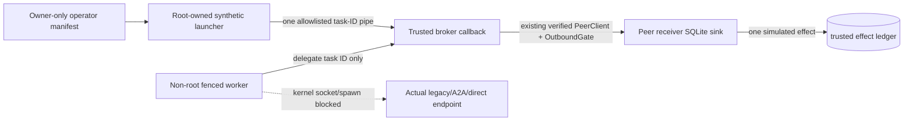

# Operator-owned broker-only secure-test profile — partial #99

**Status:** executable **synthetic Linux/x86_64 research profile**, with a distinct-UID worker behind seccomp and one independently provisioned trusted task-ID pipe broker. It is *not* a complete secure execution environment, a production launcher, a real A2A/legacy shutdown mechanism, a third-party tool PEP or a universal movement-policy claim.

## Exact reviewed execution boundary

The worker is attacker-controlled Python source running **after** irreversible UID/GID drop and a kernel socket/spawn syscall fence. The operator/supervisor is container root in a disposable CI job (not host `sudo`), owns the manifest and handler mapping, and is separately trusted to enforce grant, mandatory principal consent, identity, policy and current authorization through the existing signed peer/continuity code.



This is the **brokering-only profile**, not an assertion that all 16 candidate routes are active and independently guarded. The supervisor does not start legacy HTTP, A2A, relocation, or independent tool-service listeners. An *existing independently launched* legacy/A2A listener may remain accessible to other processes with sockets; the new worker cannot create a socket to reach it. The ordinary unenrolled legacy path remains intentionally insecure when accessed by an unfenced process. **Never equate a blocked worker's request with a globally disabled service**.

The operator manifest is a **0600 regular file owned by the launcher UID**, opened with `O_NOFOLLOW`, bounded to 8192 bytes and parsed with duplicate-key rejection. The schema is exact:

```json
{
  "schema": "amv-broker-only-secure-test-v1",
  "worker_uid": 65534,
  "worker_gid": 65534,
  "allowed_task_ids": ["task-1"],
  "enabled_routes": ["egress_child", "peer_card", "peer_preflight", "peer_delivery"]
}
```

The enabled route names mean only **operator-selected broker activities**. They are not direct socket interfaces available to the worker. The manifest cannot enable any other known route, including legacy/A2A, relocation, bare core gateway, arbitrary tools or the unintegrated independent tool-effect service. All **16 known route IDs and their class** are cross-checked against `data/secure-route-inventory.csv`; a changed/missing classification, unknown route, reordered/duplicated actor task or unreviewed promotion fails closed.

The operator binds *exactly* one callback per approved task ID. Callbacks must use the signed peer grant, `OutboundGate`, and target-side effect checks; the child supplies **no grant, destination, signature, payload text, approval boolean, arbitrary code/tool arguments, or policy version** through the broker. `run_guarded_agent` independently enforces the UID+syscall boundary and fails without Linux root supervisor. Unsupported `fork/clone/replicate/relocate` instructions never reach the callback.

## Measured research controls

The real-backend test runs an actual `http.make_server` legacy endpoint. A deliberately **unfenced trusted test request** reaches it and creates `handoff.accepted` + `handoff.completed` (RED visibility control). An uncooperative child process then probes its **real port** via legacy handoff, peer preflight, A2A JSON-RPC/REST and independent tool path plus other sockets/spawn; the syscall fence blocks those before any socket creation. The **trusted legacy SQLite audit remains unchanged**. An operator-approved broker callback then runs the signed synthetic peer delegation and yields **one** committed simulated effect observed in the receiver-owned ledger.

Separate negative tests verify operator manifest permissions/symlink/duplicate-key validation, exact source-linked route inventory and mutation, callback map mismatch, wrong allowed destination **before any peer wire task data**, and attempted `replicate` with zero authorized effects. All task text is synthetic, retained only inside the trusted test fixtures; published sanitized evidence contains route labels, UID and effect counts only.

CI: `.github/workflows/uid-worker-boundary.yml` reuses the ephemeral nonprivileged-worker container-root job from [the distinct-UID experiment](uid-worker-sandbox.md). The job must output `profile-allow.json` and `profile-deny.json` after its root-only tests; a skip or missing kernel feature **fails CI**. Ordinary no-root Python jobs check manifest and profile refusal semantics but skip only the root-specific kernel evidence.

## Independent sink-consistency check (2026-10-17)

The operator-owned `BrokerOnlyProfile.run` now requires the actual trusted
`SQLiteStore` whose `authorized_effects` table is owned by the peer target.
It snapshots that ledger independently **before and after** the broker invocation.
A reported `committed` result without exactly one newly committed effect for
the allowed task is refused, as is any ledger mutation accompanying `denied`,
`replayed`, `invalid_request` or `not_requested`. Unexpected removal of
effects also fails closed. The target ledger must exist; a missing table is
an error rather than evidence of zero effects.

The red control deliberately supplies a trusted callback that merely returns
`committed` without writing any target effect: the profile rejects its
success claim. The real signed peer callback continues to pass, while
wrong-destination and unsupported operations leave the target ledger unchanged.

**Limit:** this consistency oracle is inside the trusted supervisor using a
single SQLite store, not a separate host/kernel/service PEP. A compromised
supervisor/DB can falsify both the callback result and the ledger. A timeout
or an external effect with an unknown outcome still requires reconciliation
rather than a success claim. This narrows a false-positive proof path but
does **not** disable foreign listeners, measure every disclosure or finish #99.
## Unsupported / remaining #99 acceptance

- **This profile is NOT global route supervision.** It does not discover or terminate foreign processes, protect arbitrary shared UNIX sockets, close writable storage/FD channels other than the enumerated tested ones, or prevent a separate non-fenced program from making a legacy/A2A request. Requiring `owner_uid == 0` inside a container is a CI test model, not a deployable identity/secrets architecture.
- The operator's selected callback must independently enforce signed user grant and consent; this prototype **does not provision a full separate peer process nor the independent tool-service process**, and does not synchronize their different SQLite stores or maintain a global allow/deny ledger.
- The child has no model-provided long-lived secret, real tool, private documents, network egress or external resources. Device identity, actual remote peers, clock compromise, receipt loss across systems and unknown third-party effects are outside this local result.
- The RED legacy acceptance control is *deliberate* and only proves the real handler would have been reachable to an unfenced caller. A missing observation must not be reported as a blocked route. Official A2A SDK positive controls and independently restricted probes remain separately tested in [the real adapter experiment](real-adapter-egress.md).
- The allowlisted broker can only create synthetic peer effects, not directly execute unauthorized code, touch tools or expose secrets. This is not a proof that arbitrary plugged-in callbacks are safe: the **trusted parent** is responsible for installing correct ones.

**Conclusion:** This is a new explicit, fail-closed research launcher for a single reviewed **broker-only** path, rather than 16-route complete mediation. Umbrella [#50](https://github.com/MSKazemi/agent-movement/issues/50) and profile [#99](https://github.com/MSKazemi/agent-movement/issues/99) remain **open** for actual jointly run peer + target tool-service integration, full listener process ownership and cross-path pre-disclosure/effect reconciliation.
